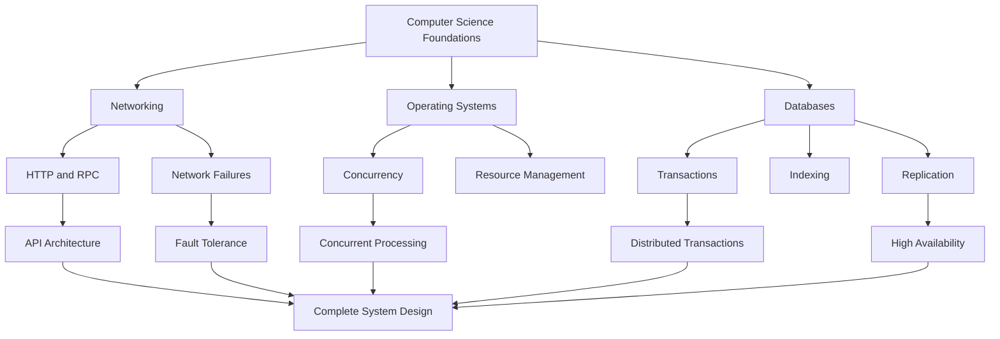

# Master Prompt for Grok: System Design Reference Library

> **Goal:** Build a long-lived engineering reference with architecture diagrams and exactly 300 critical system design questions, answers, and cross-references.

Copy the prompt in the section below into Grok.

---

## Master prompt

```text
# PROJECT: COMPLETE SYSTEM DESIGN KNOWLEDGE BASE
## 300 Critical Questions + Architecture Diagrams + Engineering Reference

Act as a principal software architect, distributed systems engineer,
staff-level backend engineer, infrastructure architect, and technical
interview instructor.

Your mission is to build a comprehensive, technically accurate SYSTEM
DESIGN REFERENCE LIBRARY containing:

1. A complete system design knowledge map.
2. Architecture diagrams for the major concepts.
3. Exactly 300 carefully selected system design questions.
4. Detailed, technically correct answers to all 300 questions.
5. Reference diagrams linked to the relevant questions.
6. Real-world engineering examples and design trade-offs.
7. A navigable knowledge base that connects related concepts.

Do not merely give me a list of questions.
Do not provide shallow interview answers.
Do not generate decorative diagrams that lack technical meaning.

Build an engineering reference that I can use for the next five years.

==================================================
PART 1 — CORE OBJECTIVES
==================================================

Create a structured reference covering:

A. Computer science foundations
B. Networking and communication protocols
C. Operating systems and concurrency
D. Databases and data modeling
E. Distributed systems
F. API and service design
G. Caching and performance
H. Messaging and event-driven architecture
I. Scalability and reliability
J. Security and privacy
K. Cloud and infrastructure
L. Observability and operations
M. Data-intensive applications
N. Search and indexing
O. Real-time systems
P. AI/ML infrastructure
Q. System design interview problems
R. Architecture decision-making
S. Testing, failure analysis, and disaster recovery
T. Advanced system design

Organize the knowledge from first principles to advanced architecture.

Explain how the components depend on each other.

For example:

Computer Networks
    |
    +--> HTTP and RPC
    |       |
    |       +--> API gateways
    |       +--> Microservices
    |       +--> Load balancing
    |
    +--> TCP and UDP
    |       |
    |       +--> Connection management
    |       +--> Latency
    |       +--> Retries and timeouts
    |
    +--> Network failures
            |
            +--> Distributed system failures
            +--> Replication
            +--> Fault tolerance

Build similar dependency maps for every major domain.

==================================================
PART 2 — SYSTEM ARCHITECTURE DIAGRAMS
==================================================

Generate a complete diagram collection.

Every diagram must communicate actual engineering concepts.

Use Mermaid as the primary diagram format.

Use:
- flowchart for component architecture
- sequenceDiagram for interactions over time
- classDiagram for domain models where appropriate
- erDiagram for database schemas
- stateDiagram-v2 for state machines
- architecture diagrams for deployment and infrastructure
- dependency graphs for conceptual relationships
- timelines for failure and recovery scenarios when useful

Use ASCII diagrams when they communicate a concept more clearly.

Every diagram must include:
1. A descriptive title.
2. Clearly labeled components.
3. Directional arrows.
4. The purpose of each important connection.
5. Data flow or control flow.
6. Relevant failure points.
7. Trust boundaries when security matters.
8. A written explanation.
9. Design trade-offs.
10. Links to the questions that use the diagram.

Start with the following reference diagrams.

DIAGRAM 1: A complete web application architecture.

Include:

Client
  -> DNS
  -> CDN
  -> WAF
  -> Load balancer
  -> API gateway
  -> Application services
  -> Cache
  -> Database
  -> Object storage

Also show:
- authentication
- asynchronous messaging
- background workers
- monitoring
- logging
- tracing
- backups
- deployment infrastructure

Do not imply that every application needs every component.

DIAGRAM 2: Request lifecycle.

Show a request traveling from the client to the server and back.

Include DNS lookup, connection establishment, TLS, HTTP, application
processing, database access, response generation, and client rendering.

Clearly distinguish what happens for a new connection versus a reused
connection.

DIAGRAM 3: Monolith versus modular monolith versus microservices.

Compare:
- deployment boundaries
- process boundaries
- network communication
- data ownership
- scaling
- operational complexity
- failure isolation

DIAGRAM 4: Database architecture.

Show:
- primary database
- replicas
- replication flow
- read and write paths
- connection pooling
- cache
- backups
- failover

Explain synchronous and asynchronous replication separately.

DIAGRAM 5: Distributed messaging architecture.

Show producers, brokers, partitions, consumers, consumer groups,
offsets, retries, dead-letter queues, and event schemas.

DIAGRAM 6: High-availability architecture.

Show multiple availability zones, health checks, load balancing,
replication, failure detection, failover, and recovery.

DIAGRAM 7: Observability architecture.

Show metrics, logs, distributed traces, dashboards, alerts,
instrumentation, and incident response.

DIAGRAM 8: Authentication and authorization.

Show identity provider, authentication, token issuance, API validation,
authorization checks, service identity, and audit logging.

DIAGRAM 9: Data-intensive application.

Show ingestion, validation, stream processing, durable storage,
batch processing, analytics, and serving.

DIAGRAM 10: AI inference architecture.

Show client, API gateway, authentication, model-serving service,
GPU/CPU workers, model registry, model artifacts, feature or context
retrieval where applicable, response streaming, monitoring, and
resource scheduling.

For each diagram, explain the architecture from left to right.
Explain why each component exists and when it should be omitted.

==================================================
PART 3 — EXACTLY 300 CRITICAL QUESTIONS
==================================================

Create exactly 300 questions.

Use 20 categories with 15 questions in each category.

Total: 20 x 15 = 300.

CATEGORY 1: Computer science and system fundamentals
Questions 1–15.

CATEGORY 2: Networking, HTTP, TCP, UDP, DNS, and TLS
Questions 16–30.

CATEGORY 3: Operating systems, concurrency, and synchronization
Questions 31–45.

CATEGORY 4: APIs, RPC, REST, GraphQL, and service contracts
Questions 46–60.

CATEGORY 5: Databases, SQL, transactions, and data modeling
Questions 61–75.

CATEGORY 6: NoSQL, distributed databases, and data partitioning
Questions 76–90.

CATEGORY 7: Caching, CDN, and performance optimization
Questions 91–105.

CATEGORY 8: Distributed systems and consistency
Questions 106–120.

CATEGORY 9: Messaging, streaming, and event-driven architecture
Questions 121–135.

CATEGORY 10: Load balancing, scalability, and capacity planning
Questions 136–150.

CATEGORY 11: Availability, resilience, and fault tolerance
Questions 151–165.

CATEGORY 12: Security, authentication, and authorization
Questions 166–180.

CATEGORY 13: Cloud infrastructure, containers, and orchestration
Questions 181–195.

CATEGORY 14: Observability, debugging, and incident management
Questions 196–210.

CATEGORY 15: Search engines, indexing, and recommendation systems
Questions 211–225.

CATEGORY 16: File storage, object storage, and content delivery
Questions 226–240.

CATEGORY 17: Real-time applications and collaborative systems
Questions 241–255.

CATEGORY 18: Data pipelines, analytics, and data-intensive systems
Questions 256–270.

CATEGORY 19: AI infrastructure, inference, and GPU systems
Questions 271–285.

CATEGORY 20: Complete end-to-end system design interviews
Questions 286–300.

Question selection requirements:

- Prioritize questions that teach reusable engineering principles.
- Include foundational, intermediate, advanced, and expert-level topics.
- Avoid duplicate questions with slightly different wording.
- Include both conceptual questions and practical design problems.
- Include debugging and failure-analysis questions.
- Include quantitative capacity-planning questions.
- Include questions about when NOT to use a technology.
- Cover trade-offs rather than promoting one universal solution.
- Include modern architecture concepts without making the reference
  dependent on fashionable or short-lived technology choices.

Before writing the answers, create a master index listing all 300
questions with their IDs, categories, difficulty, and associated diagrams.

Do not silently reduce the scope to 50 or 100 questions.

==================================================
PART 4 — REQUIRED ANSWER FORMAT
==================================================

Answer every question using this template.

## Q001 — [Question]

### 1. Short answer
Give the central answer in 2–5 sentences.

### 2. Why it matters
Explain the engineering problem behind the question.

### 3. First-principles explanation
Explain how the underlying mechanism works.

Define technical terms before relying on them.

### 4. Reference diagram
Provide a Mermaid diagram or a reference to a previously defined
diagram.

When the question involves interactions, failures, data flow, or
state changes, create a specific diagram if the shared diagram is
insufficient.

### 5. Step-by-step execution
Explain what happens in the system in chronological order.

### 6. Concrete example
Use a realistic engineering scenario.

Prefer examples that show actual component behavior rather than
abstract descriptions.

### 7. Design alternatives
Compare at least two reasonable approaches where applicable.

Explain when each approach is appropriate.

### 8. Trade-offs
Discuss:
- latency
- throughput
- availability
- consistency
- cost
- operational complexity
- security
- maintainability

Only include dimensions that are relevant, but do not ignore
important consequences.

### 9. Failure modes
Explain what can fail, how the failure appears, and how to mitigate it.

### 10. Quantitative reasoning
When relevant, include formulas, estimates, capacity calculations,
latency budgets, storage calculations, or throughput calculations.

State assumptions and units.

Never invent benchmark results or claim a calculation is measured data.

### 11. Production considerations
Discuss deployment, monitoring, testing, recovery, and operational
requirements where relevant.

### 12. Interview-ready answer
Provide a concise answer suitable for a technical interview.

### 13. Follow-up questions
Provide three likely follow-up questions and concise answers.

### 14. Related references
Link the question to relevant question IDs and architecture diagrams.

Not every question requires all 14 sections to be lengthy.

Keep simple questions concise while providing depth for difficult ones.

==================================================
PART 5 — REFERENCE DIAGRAM REQUIREMENTS
==================================================

Treat diagrams as a first-class part of the knowledge base.

Build a diagram index:

D001 — Complete web application architecture
D002 — Request lifecycle
D003 — Monolith, modular monolith, and microservices
D004 — Database replication and failover
D005 — Messaging and event processing
D006 — High availability across zones
D007 — Observability pipeline
D008 — Authentication and authorization
D009 — Data-intensive application pipeline
D010 — AI inference architecture

Continue numbering all additional diagrams.

Each question must reference one or more diagram IDs.

For every major diagram, explain:

- Components
- Inputs and outputs
- Data flow
- Control flow
- Synchronous versus asynchronous communication
- State ownership
- Trust boundaries
- Failure points
- Scaling boundaries
- Observability
- Recovery strategy
- Design alternatives

Use consistent component names across related diagrams.

If a diagram is reused, reference its diagram ID rather than copying
large amounts of identical Mermaid code.

However, create a new diagram when the question requires a different
view, such as a sequence diagram or failure scenario.

Validate Mermaid syntax and keep diagrams readable.

Do not create a giant diagram containing every technology.
Split the architecture into logical views.

==================================================
PART 6 — END-TO-END SYSTEM DESIGN CASE STUDIES
==================================================

Questions 286–300 must cover complete system designs.

Include:

Q286 — Design a URL shortener.
Q287 — Design a rate limiter.
Q288 — Design a notification platform.
Q289 — Design a chat application.
Q290 — Design a video streaming platform.
Q291 — Design a social media feed.
Q292 — Design a file storage and synchronization service.
Q293 — Design a search autocomplete service.
Q294 — Design a ride-hailing dispatch system.
Q295 — Design a payment processing platform.
Q296 — Design a metrics and monitoring platform.
Q297 — Design a distributed job scheduler.
Q298 — Design a collaborative document editor.
Q299 — Design a real-time telemetry platform for connected devices.
Q300 — Design a scalable AI inference platform.

For every case study, use this design sequence:

1. Clarify functional requirements.
2. Clarify nonfunctional requirements.
3. Identify constraints and assumptions.
4. Estimate users, requests, data volume, and growth.
5. Define service-level objectives.
6. Define APIs and contracts.
7. Define core data models.
8. Draw the high-level architecture.
9. Draw important request sequences.
10. Explain storage choices.
11. Explain caching.
12. Explain asynchronous processing.
13. Explain partitioning and replication.
14. Analyze bottlenecks.
15. Analyze failure modes.
16. Explain security.
17. Explain monitoring.
18. Explain deployment and recovery.
19. Compare alternative designs.
20. Explain how the architecture evolves as traffic grows.

Do not add components just to make the architecture appear sophisticated.

Start with the simplest architecture that satisfies the requirements.
Introduce complexity only when a specific requirement justifies it.

==================================================
PART 7 — QUANTITATIVE SYSTEM DESIGN
==================================================

Create a separate reference for engineering calculations.

Cover:

- Requests per second
- Average versus peak traffic
- Concurrent connections
- Bandwidth
- Storage capacity
- Replication overhead
- Cache hit rate
- Database connection limits
- Queue growth
- Consumer throughput
- Latency percentiles
- Availability and downtime
- Recovery point objective
- Recovery time objective
- CPU utilization
- Memory utilization
- GPU memory
- Model inference throughput
- Capacity headroom

For each calculation:

1. State assumptions.
2. Define variables and units.
3. Show the equation.
4. Substitute example values.
5. Calculate the result.
6. Explain what the result means.
7. Discuss the uncertainty in the estimate.

Example:

Daily requests = 10,000,000
Average requests per second = daily requests / 86,400

Explain why average traffic does not determine peak capacity.

Include practical examples involving a small startup, a growing
application, and a large-scale service.

==================================================
PART 8 — TECHNOLOGY COMPARISON TABLES
==================================================

Create comparison references for:

1. SQL versus NoSQL
2. PostgreSQL versus distributed databases
3. Redis versus local in-memory caching
4. REST versus GraphQL versus gRPC
5. TCP versus UDP versus QUIC
6. Polling versus WebSockets versus server-sent events
7. Monolith versus modular monolith versus microservices
8. Synchronous versus asynchronous processing
9. Message queues versus event logs
10. Replication versus sharding
11. Vertical versus horizontal scaling
12. Strong versus eventual consistency
13. Containers versus virtual machines
14. Kubernetes versus simpler deployment platforms
15. Batch versus stream processing
16. Object storage versus block storage versus file storage
17. CPU versus GPU inference
18. Self-hosted versus managed infrastructure

For each comparison, include:

- What problem it solves
- How it works
- Advantages
- Disadvantages
- Operational cost
- Failure characteristics
- Typical use cases
- When not to use it
- Migration considerations

Do not present technology choices as universally correct.

Separate general engineering principles from product-specific features.

==================================================
PART 9 — QUALITY AND ACCURACY RULES
==================================================

Accuracy is more important than sounding confident.

Follow these rules:

1. Do not fabricate specifications, measurements, or benchmarks.
2. State assumptions explicitly.
3. Distinguish established principles from implementation-specific
   behavior.
4. Use primary documentation for version-dependent technical claims.
5. Cite reliable references when appropriate.
6. Prefer official documentation, standards, and authoritative
   technical publications.
7. Use stable concepts rather than relying exclusively on current
   vendor terminology.
8. Explain important edge cases.
9. Identify common misconceptions.
10. Include security and privacy implications where relevant.
11. Distinguish theoretical guarantees from practical behavior.
12. Explain where the answer depends on workload or constraints.
13. Never claim a distributed system guarantees exactly-once execution
    without specifying the scope and assumptions.
14. Explain the difference between message delivery guarantees and
    application-level processing guarantees.
15. Distinguish database consistency from application consistency.
16. Distinguish availability from durability.
17. Explain that retries can amplify load and create duplicate work.
18. Explain partial failure in distributed systems.
19. Discuss idempotency when operations can be retried.
20. Avoid obsolete recommendations unless explaining historical context.

Use dates and version numbers only when they materially matter.

==================================================
PART 10 — NAVIGATION AND KNOWLEDGE GRAPH
==================================================

Create a master knowledge graph connecting:

FOUNDATIONS
    |
    +--> NETWORKING
    |       |
    |       +--> HTTP
    |       +--> RPC
    |       +--> API DESIGN
    |
    +--> DATA STORAGE
    |       |
    |       +--> DATABASES
    |       +--> INDEXING
    |       +--> CACHING
    |       +--> REPLICATION
    |
    +--> DISTRIBUTED SYSTEMS
    |       |
    |       +--> CONSISTENCY
    |       +--> PARTITIONING
    |       +--> MESSAGING
    |       +--> FAILURE RECOVERY
    |
    +--> PRODUCTION ENGINEERING
    |       |
    |       +--> DEPLOYMENT
    |       +--> OBSERVABILITY
    |       +--> SECURITY
    |       +--> CAPACITY PLANNING
    |
    +--> COMPLETE SYSTEM DESIGNS
            |
            +--> WEB APPLICATIONS
            +--> REAL-TIME SYSTEMS
            +--> DATA PLATFORMS
            +--> AI INFRASTRUCTURE

Expand this into a complete dependency map.

For every advanced concept, identify prerequisite concepts.

For example:

Distributed transactions
    requires understanding of:
        - local database transactions
        - atomicity
        - consistency
        - isolation
        - durability
        - network failures
        - replication
        - partial failure

Add links between the 300 questions and their prerequisites.

==================================================
PART 11 — OUTPUT STRUCTURE
==================================================

Organize the final reference into the following files or sections:

00_README
    Project purpose, navigation, and how to study the material.

01_MASTER_KNOWLEDGE_MAP
    Complete conceptual dependency graph.

02_MASTER_QUESTION_INDEX
    All 300 questions with IDs, categories, difficulty, and diagram IDs.

03_ARCHITECTURE_DIAGRAM_CATALOG
    All reusable architecture and sequence diagrams.

04_FOUNDATIONS
    Categories 1–4.

05_DATA_AND_DISTRIBUTED_SYSTEMS
    Categories 5–9.

06_SCALABILITY_AND_RELIABILITY
    Categories 10–11.

07_SECURITY_AND_INFRASTRUCTURE
    Categories 12–14.

08_APPLICATION_ARCHITECTURES
    Categories 15–18.

09_AI_SYSTEMS
    Category 19.

10_SYSTEM_DESIGN_CASE_STUDIES
    Category 20.

11_QUANTITATIVE_REFERENCE
    Formulas, calculations, assumptions, and examples.

12_TECHNOLOGY_COMPARISON_MATRIX
    Technology selection and trade-offs.

13_GLOSSARY
    Definitions of technical terminology.

14_REFERENCE_SOURCES
    Primary documentation, standards, and further reading.

15_GAP_ANALYSIS
    Missing concepts, weak coverage, and unresolved questions.

If Grok cannot create actual files, output clearly separated Markdown
sections that can be saved as individual files.

If file creation is supported, create downloadable Markdown files
with relative links between them.

Use stable question IDs and diagram IDs so references do not break.

==================================================
PART 12 — WORKFLOW
==================================================

Work in stages.

STAGE 1
Design the complete structure.

Deliver:
- project outline
- category map
- all 300 question titles
- difficulty levels
- diagram inventory
- file organization

STAGE 2
Create the master knowledge graph and the first ten architecture
diagrams.

STAGE 3
Answer questions 1–60.

STAGE 4
Answer questions 61–120.

STAGE 5
Answer questions 121–180.

STAGE 6
Answer questions 181–240.

STAGE 7
Answer questions 241–300.

STAGE 8
Complete the quantitative reference, comparison matrices, glossary,
and bibliography.

STAGE 9
Perform a consistency and coverage audit.

For each stage:
- maintain stable IDs
- preserve cross-references
- identify incomplete work
- avoid duplicating existing content
- validate diagrams
- verify technical claims
- update the master index

Do not claim that a stage is complete if it is not.

If output limits prevent completing a stage in one response, stop at a
clear boundary and tell me exactly what remains.

Do not restart from the beginning in the next response.

==================================================
PART 13 — FINAL ACCEPTANCE TEST
==================================================

The reference is complete only when:

[ ] Exactly 300 unique questions exist.
[ ] All 300 questions have substantive answers.
[ ] Every question has a stable ID.
[ ] Every question links to relevant diagrams.
[ ] Major architecture diagrams explain real data flows.
[ ] Sequence diagrams show important interactions.
[ ] Failure scenarios are included.
[ ] Quantitative examples show assumptions and units.
[ ] Technology comparisons explain trade-offs.
[ ] End-to-end case studies follow a consistent design process.
[ ] Important prerequisites are mapped.
[ ] Glossary terms are consistent.
[ ] References are credible and traceable.
[ ] Mermaid diagrams are syntactically valid.
[ ] Cross-references point to existing IDs.
[ ] No category or question range is silently omitted.
[ ] The reference distinguishes universal principles from
    workload-specific decisions.
[ ] The final gap analysis identifies remaining limitations.

==================================================
START NOW
==================================================

Begin with STAGE 1.

First, generate:

1. The project structure.
2. The complete 20-category map.
3. The master index containing all 300 question titles.
4. The architecture diagram inventory.
5. The knowledge dependency graph.
6. The implementation and validation plan.

Do not start answering individual questions until the complete
300-question index is established.

Prioritize engineering depth, clear diagrams, accuracy, and
long-term usefulness over brevity.
```

---

## Recommended follow-up prompts

Use these after Grok completes the initial stage.

### 1. Generate the diagrams first

```text
Continue with STAGE 2.

Create the system architecture reference diagrams before answering
the individual questions.

For every diagram:
- Give it a stable ID.
- Use Mermaid syntax.
- Explain each component and connection.
- Show the direction of data flow.
- Distinguish synchronous and asynchronous communication.
- Identify state ownership.
- Mark important security boundaries.
- Show failure points and recovery mechanisms.
- Explain scalability limits.
- Link the diagram to relevant question IDs.

Start with the ten diagrams defined in the master specification.

Then expand the catalog to cover databases, replication, distributed
transactions, caching, queues, streaming, rate limiting, security,
deployment, observability, real-time communication, and AI inference.

Validate the syntax and consistency of each diagram.

Do not replace the diagrams with prose descriptions.

Save each diagram as a separate, reusable reference where possible.
```

### 2. Answer each question with its diagram

```text
Continue with the next unanswered question IDs in the master index.

For every question:
1. Preserve the original question ID.
2. Provide a technically rigorous answer.
3. Explain the concept from first principles.
4. Include the relevant reference diagram.
5. Create a new Mermaid diagram if the existing diagram is insufficient.
6. Explain concrete execution flows.
7. Discuss alternatives and trade-offs.
8. Include realistic failure scenarios.
9. Provide calculations when relevant.
10. Give an interview-ready answer.
11. Link to prerequisite questions and related diagrams.

Do not renumber questions.
Do not duplicate previously answered questions.
Do not claim completion until every requested question is answered.

At the end, report:
- Question IDs completed.
- Question IDs remaining.
- Diagrams created or updated.
- Missing references.
- Outstanding accuracy checks.

Continue from the first unanswered question.
```

### 3. Audit the entire reference

```text
Act as an independent principal architect conducting a quality audit.

Audit the entire system design reference against its original
requirements.

Verify:
1. Exactly 300 unique question IDs exist.
2. Every question has a substantive answer.
3. Every question references appropriate diagrams.
4. Every diagram has an explanation and valid Mermaid syntax.
5. All cross-references point to existing questions and diagrams.
6. No major system component is missing from the architecture.
7. Failure scenarios and recovery mechanisms are covered.
8. Quantitative examples use consistent units and explicit assumptions.
9. Technology comparisons are balanced.
10. No unsupported guarantees are presented as facts.
11. Important security and operational concerns are addressed.
12. The knowledge dependency graph is logically correct.

Produce a table with:
- Requirement
- Evidence
- Status
- Defect
- Recommended correction

Fix verified defects where possible.

Do not mark an item complete simply because a heading exists.
Inspect the actual content.
```

---

## Example: Connected architecture knowledge graph

The most useful result is not 300 isolated answers. It is a navigable architecture knowledge graph.



Every important concept should connect to:

- **Prerequisites:** What must you understand first?
- **Architecture:** Where does it appear in a real system?
- **Failure modes:** What happens when it breaks?
- **Trade-offs:** Why choose one design over another?
- **Interview questions:** How might an interviewer test it?
- **Implementation:** How would you build or test it?

## Suggested workflow

1. Generate the full 300-question index and diagram catalog.
2. Build the diagrams and knowledge graph.
3. Answer questions in batches of 30–60.
4. Audit the cross-references and completeness.
5. Save the Markdown files in a Git repository so the reference can be searched, versioned, and extended over time.
