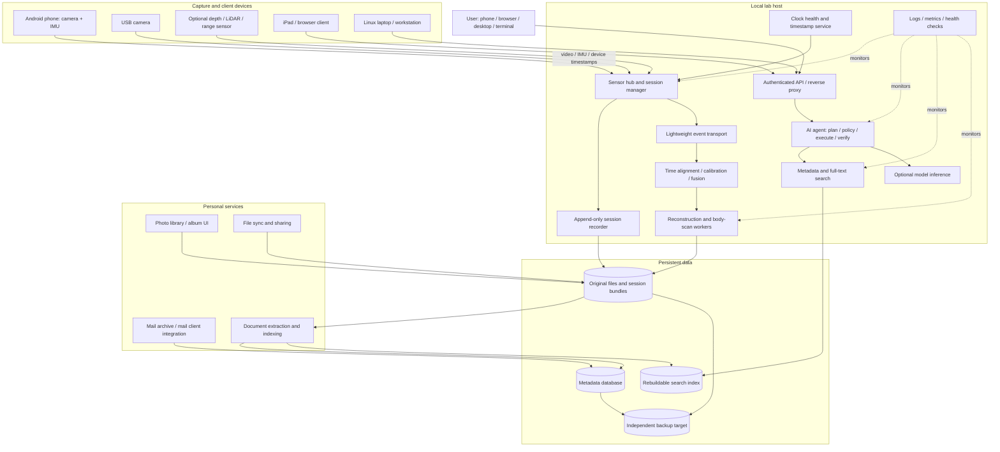
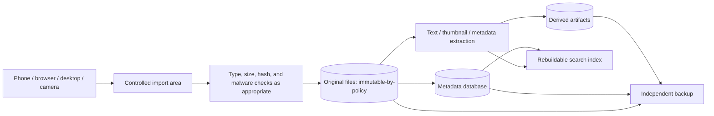
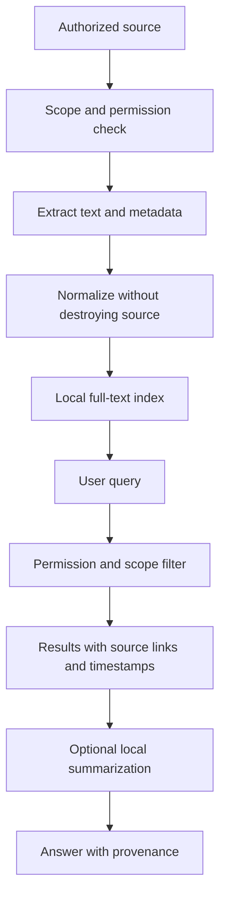
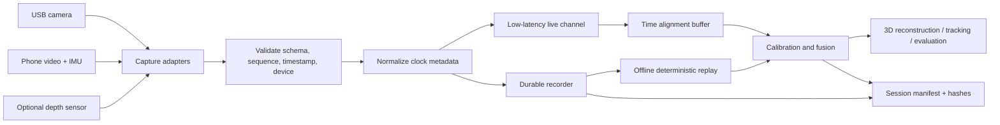
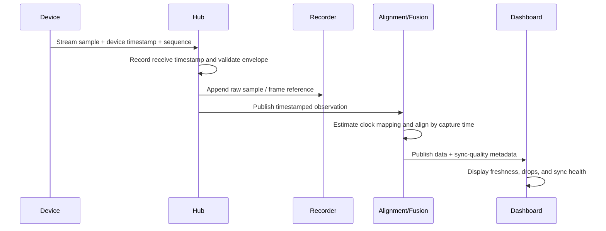
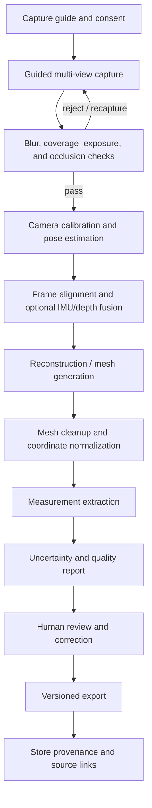
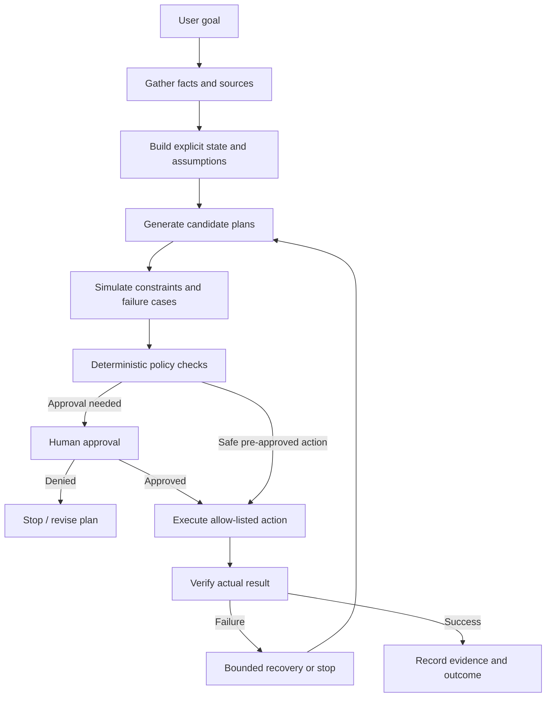
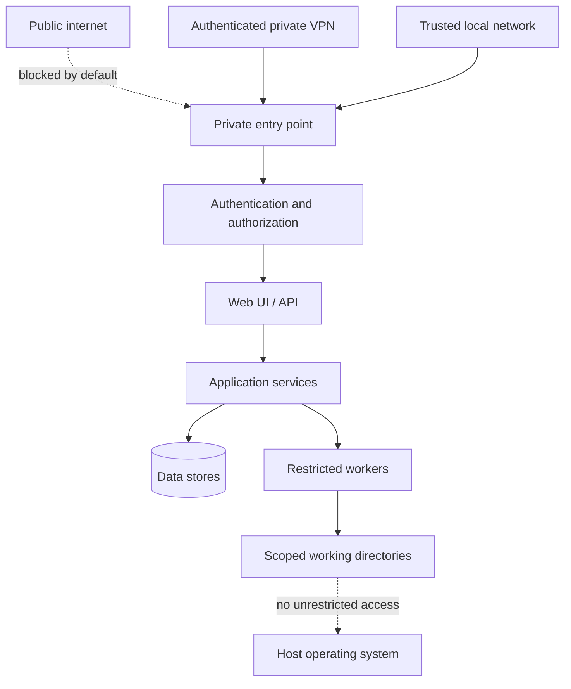
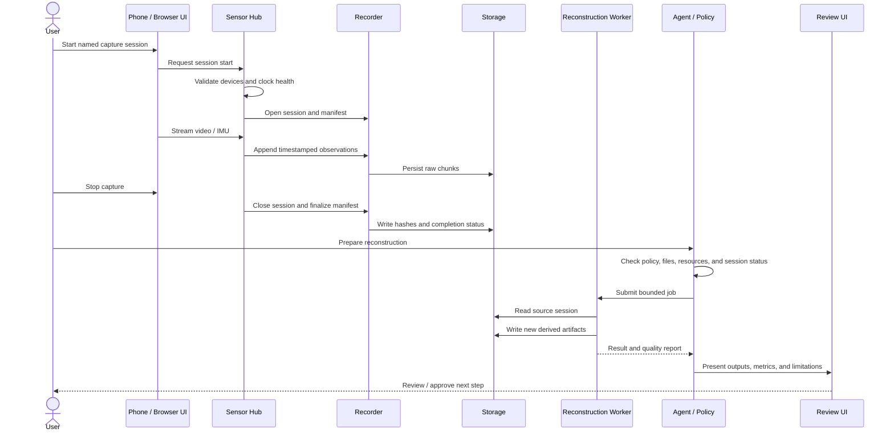

# Personal AI + Physical AI Lab
## Whole-Lab System Architecture, Service Map, and Phased Implementation Plan

**Status:** Architecture proposal  
**Version:** 0.1  
**Scope:** Local-first personal cloud, safe AI automation, multi-device sensor streaming, 3D/body scanning, and AI-assisted data search  
**Primary design constraint:** Build a reliable small system on existing hardware before adding heavyweight services or cloud infrastructure.

> **Important:** This is a proposed architecture, not a claim that every service is installed or that every target has already been measured. Service choices are candidates. Validate current versions, hardware compatibility, licensing, and resource use before deployment.

---

# 1. Executive summary

The lab should be treated as one ecosystem with several independent applications sharing a small, carefully controlled platform:

1. **Personal cloud:** files, photos, metadata, search, synchronization, and backup.
2. **Personal AI agent:** turns a goal into a plan, checks constraints, requests approval for consequential actions, executes permitted tools, and verifies outcomes.
3. **Physical AI sensor platform:** captures camera, phone inertial measurement unit (IMU), and optional range/depth data with timestamps and calibration metadata.
4. **3D reconstruction and body-scanning pipeline:** converts captured images and optional depth data into a quality-checked 3D representation and measurements.
5. **AI/data services:** indexing, model inference, experiment tracking, and retrieval across approved personal and lab data.
6. **Operations and safety:** identity, private networking, storage protection, logs, backups, resource budgets, and validation.

The platform must not become a large collection of always-running containers on a laptop with limited memory. Start with one working path at a time. Keep data formats portable and service boundaries explicit.

## 1.1 Known baseline and assumptions

The currently documented baseline includes:

- Acer Aspire A315-510P laptop.
- Intel Core i3-N305 processor, 8 CPU cores.
- Approximately 7.4 GiB RAM in one recorded report; actual available memory must be re-measured before deployment.
- Approximately 512 GB internal Micron 2450 storage.
- Xubuntu/Linux environment.
- External storage has been used; its identity, health, filesystem, and backup status must be rediscovered before any disk operation.
- Logitech C920-class USB camera.
- Redmi Note 10 Pro phone with camera and inertial sensors.
- iPad Air 2 and MacBook Air Intel as additional clients/devices.
- Existing Physical AI Lab work includes a local hub, remote client, camera stream, TLS/WebSocket-related components, and a dashboard. The actual current repository state must be inspected before implementation.

These are contextual inputs, not a fresh hardware audit. **Re-run read-only discovery** before installing services or changing storage.

## 1.2 Core design principles

- **Local-first:** data stays local unless remote access or a cloud model is deliberately enabled.
- **Small baseline:** one service per capability where possible; avoid duplicating databases, identity systems, and message brokers.
- **Evidence before action:** record source, timestamp, confidence, and validation state for important facts.
- **Human approval:** required for destructive storage actions, purchases, external publishing, sensitive sharing, and irreversible operations.
- **Portable data:** use documented formats and ordinary files where practical; make exports and migrations possible.
- **Measured timing:** distinguish sensor capture time, device time, hub receive time, processing time, and display time.
- **Graceful degradation:** sensor recording and core file access should continue even if an AI model or optional indexer is unavailable.
- **No false precision:** accuracy and latency goals are hypotheses until measured on the real hardware.
- **Reproducibility:** record configuration versions, software versions, calibration, and dataset identifiers.
- **Incremental rollout:** observe → design → prototype → measure → harden → expand.

---

# 2. Whole-lab system map



## 2.1 Trust and responsibility boundaries

- **Capture devices** produce observations. They do not decide which data is trustworthy.
- **Sensor hub** manages sessions, validates messages, and preserves timestamps and device identity.
- **Recorder** writes raw data and manifests before optional processing. It must not silently overwrite raw sessions.
- **Processing workers** derive synchronized, fused, reconstructed, or inferred outputs. Derived outputs must point back to source data and configuration.
- **Agent orchestrator** proposes and coordinates actions. Ordinary deterministic code enforces policies and approval gates.
- **Personal services** provide user experience but should not own the only copy of important data.
- **Search indexes and model caches** are derived data and should be rebuildable.
- **Backup target** must be independent enough that failure or deletion of the primary disk does not delete the only backup.

---

# 3. Top-level subsystem catalogue

| ID | Subsystem | Main responsibility | Inputs | Outputs | Initial priority |
|---|---|---|---|---|---|
| S1 | Platform and machine inventory | Discover CPU, RAM, disks, OS, network, services | Host state | Audited baseline | P0 |
| S2 | Identity and private access | Authenticate users and limit network exposure | User/session credentials | Authorized requests | P0 |
| S3 | Storage and backup | Preserve originals, versions, manifests, and backups | Files and session bundles | Durable, recoverable data | P0 |
| S4 | Personal cloud | File access, synchronization, sharing | Files and metadata | Web/mobile/desktop access | P1 |
| S5 | Search and document pipeline | Extract text and index approved content | Documents and metadata | Search results with provenance | P2 |
| S6 | Sensor capture and hub | Ingest video, IMU, optional depth, and events | Device streams | Timestamped recordings | P0 for Physical AI |
| S7 | Clock and synchronization | Track clock offsets, drift, and timestamp quality | Device clocks and timing probes | Sync quality report | P0 for Physical AI |
| S8 | Sensor fusion and reconstruction | Align observations and build 3D outputs | Recorded sessions | Calibrated, fused artifacts | P1 |
| S9 | Body scanning and fit | Estimate body surface/measurements and fit uncertainty | Guided images/video/depth | Mesh, measurements, quality report | P2 |
| S10 | AI agent and policy engine | Plan, simulate, ask approval, execute, verify | Goal and tools | Auditable run | P2 |
| S11 | Model inference | Run optional perception, language, or geometry models | Approved inputs | Model outputs with version metadata | P3 |
| S12 | Observability | Health, logs, metrics, timing, disk and failure alerts | All services | Debuggable evidence | P0 |
| S13 | Deployment and configuration | Reproducible startup, service isolation, updates | Config and versioned artifacts | Repeatable environment | P1 |

P0 means required before expanding the lab; it does not mean all components must be deployed simultaneously.

---

# 4. Resource-aware deployment plan

## 4.1 Hardware reality

A laptop with roughly 7–8 GiB RAM can host useful lightweight services, but it is not a safe assumption that it can simultaneously run a large language model, a photo indexing pipeline, a full collaboration suite, a database, multiple video streams, and 3D reconstruction without contention.

The initial design should prioritize:

1. A stable operating system and machine inventory.
2. Reliable file storage and an independent backup.
3. One sensor stream with repeatable recording.
4. A simple metadata store.
5. Lightweight monitoring.
6. Optional services only after measuring idle and peak resource use.

## 4.2 Resource policy

| Resource | Policy |
|---|---|
| RAM | Measure baseline and peak resident memory; reserve memory for the OS and recording path. |
| CPU | Do not run CPU-heavy reconstruction concurrently with timing-critical capture unless tests prove it safe. |
| GPU / accelerator | Discover actual hardware and drivers. Do not assume CUDA or a discrete GPU exists. |
| Internal SSD | OS, code, small database, configuration, temporary data, and active indexes if space permits. |
| External disk | Candidate for large recordings and media only after its identity, health, filesystem, and backup status are confirmed. |
| Network | Start on a trusted private LAN; do not expose raw sensor or personal-cloud services directly to the public internet. |
| Containers | Use only where isolation and reproducibility justify overhead. A native process may be better for the first prototype. |
| Model inference | Treat as optional and resource-budgeted; offload to another machine or a provider only by explicit policy. |

## 4.3 Suggested deployment tiers

```text
TIER 0 — MUST WORK
  OS + disk inventory + authenticated local access
  sensor hub + recorder + session manifest
  basic logs + backup verification

TIER 1 — USEFUL DAILY SERVICES
  one file/photo service
  metadata database only if required
  lightweight search
  private remote access

TIER 2 — PROCESSING
  offline reconstruction workers
  document extraction / OCR
  body-scan quality checks
  optional model inference

TIER 3 — ADVANCED
  event bus if measured throughput requires it
  multiple workers / queue scheduling
  remote compute / cloud services
  advanced vector search or model orchestration
```

Do not deploy every tier as a single giant `docker compose` stack on day one.

---

# 5. Candidate self-hosted service map

Service choices must be verified against current requirements, supported platforms, resource use, licensing, security posture, and backup/restore behavior before adoption.

| Capability | Candidate direction | Recommendation / caution |
|---|---|---|
| File sync and web access | Nextcloud, ownCloud, Syncthing, or a simpler file server | Choose one primary file workflow. Syncthing is synchronization, not a full personal-cloud portal. |
| Photo browsing | Immich, PhotoPrism, or existing file/photo workflows | Photo indexing and machine-learning features can be resource-heavy. Test a small library first. |
| Document text extraction | Apache Tika or a small Python pipeline using suitable parsers | Keep extraction separate from originals; record parser version and extraction status. |
| Search | SQLite FTS for a small first version; a dedicated search engine only when justified | Search index should be rebuildable. Avoid running several search engines. |
| Metadata | SQLite initially; PostgreSQL only when multi-user/concurrent service needs justify it | Back up metadata consistently with application data. |
| Reverse proxy | Caddy, Nginx, or Traefik | Expose only explicitly authorized routes. A reverse proxy is not authentication by itself. |
| Private remote access | Tailscale, WireGuard, or an equivalent private VPN | Choose one. Review account dependency, device trust, and key recovery. |
| Container packaging | Docker Compose or Podman Compose where suitable | Containers do not replace backups, authorization, or resource limits. |
| Logs and health | Standard structured logs plus simple health checks first | Add a metrics stack only when it answers a concrete operational question. |
| Agent orchestration | Small explicit Python state machine and policy layer | Avoid beginning with a complex multi-agent framework. |
| Message transport | In-process queue or WebSocket first; MQTT for device/event pub-sub; NATS when a stronger event bus is justified | Do not add Kafka/Redpanda for low-volume local sensor streaming without evidence it is needed. |
| Model inference | Existing model runtime selected after model and hardware audit | Keep inference off the critical capture path. |
| Mail | Existing mail provider/client integration and a local archive/index where appropriate | Running a public mail server adds major deliverability, abuse, DNS, and security burdens. Do not assume self-hosted inbound/outbound mail is needed. |
| Backups | Versioned filesystem backup to a separate disk or trusted remote target | RAID or sync alone is not a backup. Test restore. |

### Service-selection gate

For each candidate, record:

- Problem it solves.
- Required features.
- Minimum practical memory and storage.
- Supported architecture and operating systems.
- Data paths and permissions.
- Upgrade and rollback method.
- Export/migration method.
- Backup and restore steps.
- Authentication and network exposure.
- Measured idle and peak resource use.
- Decision: adopt, defer, or reject.

---

# 6. Personal cloud: files, photos, mail, and search

## 6.1 Data architecture



## 6.2 File and photo requirements

- Preserve original bytes and timestamps where practical.
- Record a cryptographic hash for important imports and session artifacts.
- Separate original files from thumbnails, OCR output, embeddings, and generated previews.
- Treat duplicate detection as a suggestion unless a safe deduplication policy is explicitly approved.
- Keep deletion recoverable through versioning or a quarantine/trash stage.
- Do not treat a synchronized deletion as safe backup behavior.
- Index only directories the user explicitly authorizes.
- Do not send private photos or documents to a hosted AI service by default.
- Support a full export path and documented restore procedure.

## 6.3 Mail and personal-data search

The initial goal should be **searching and organizing data the user already owns**, not operating a public mail server.

Possible sources:
- Locally stored mail archives.
- Exports from a supported mail client.
- User-authorized provider APIs, if connected.
- Documents, PDFs, notes, and selected folders.

Each indexed item should store:
- Stable item identifier.
- Source type and source path/provider.
- Last-modified or received timestamp when available.
- Import timestamp.
- Content hash where appropriate.
- Extraction status and parser version.
- Access-control label.
- Link to the original item.
- Whether indexing is local-only or includes an external provider.

Search results must link back to the original source. A generated summary must not replace the original evidence.

## 6.4 Search pipeline and privacy



Vector search or embeddings are optional. Add them only when keyword search and metadata filters are demonstrably insufficient. If embeddings are added, document the model, version, storage location, deletion semantics, and whether data ever leaves the machine.

---

# 7. Real-time multi-device sensor streaming

## 7.1 Devices and responsibilities

| Device | Candidate role | Data | Important limitations |
|---|---|---|---|
| Linux hub host | Session coordinator, recorder, dashboard, clock diagnostics | All streams and metadata | CPU, memory, and disk contention must be measured. |
| USB camera (e.g., C920) | RGB video capture | Frames, capture timestamps, frame counters | USB bandwidth, exposure variation, dropped frames, and driver buffering. |
| Android phone | Mobile RGB video, accelerometer, gyroscope, orientation estimates if available | Video and inertial samples | Android sensor timestamps, background execution, thermal throttling, Wi-Fi variability. |
| Optional depth / LiDAR / range sensor | Geometric observations | Point cloud, depth frames, ranges | Device-specific timestamp and calibration behavior. |
| iPad / browser | Operator dashboard and session controls | Commands, status, review | Browser display timing is not sensor capture timing. |
| External storage | Long session recordings | Raw and derived data | Must be identified and checked before use. |

## 7.2 Logical pipeline



## 7.3 Transport selection

Start with the simplest transport already present in the project.

- **WebSocket:** reasonable for a local dashboard and modest real-time event/video metadata streams.
- **HTTP upload:** useful for completed session bundles and large artifacts.
- **WebRTC:** consider if browser video latency, network adaptation, or media transport becomes a demonstrated need.
- **MQTT:** consider for compact device telemetry and publish/subscribe semantics.
- **NATS:** consider if multiple independent services need low-latency events, replay/streaming features, or durable consumers that a simple queue cannot support.
- **Kafka/Redpanda:** defer unless throughput, retention, replay, or multi-consumer requirements justify the operational and memory overhead.
- **ROS 2:** use where the project needs robotics-native messages, nodes, discovery, or integration with robotics tools. Avoid creating two competing buses without a clear boundary.

For the first milestone, keep a single authoritative recording format and one canonical session manifest even if the live transport changes later.

## 7.4 Message envelope

Every stream message should carry a documented envelope, adapted to the actual transport:

```json
{
  "schema_version": 1,
  "session_id": "session-unique-id",
  "device_id": "phone-main",
  "stream_id": "imu-gyro",
  "sequence": 12345,
  "device_timestamp_ns": 0,
  "hub_receive_timestamp_ns": 0,
  "clock_domain": "android-monotonic",
  "payload_type": "gyro_xyz",
  "units": "rad/s",
  "calibration_id": "calibration-version-or-null",
  "payload": {}
}
```

The zero timestamps and empty payload are placeholders, not valid measured values. Do not use wall-clock time alone as a high-resolution synchronization clock. Preserve original device timestamps and document the conversion to the hub timeline.

## 7.5 Session manifest

Each recording should have a manifest containing:

- Session ID and start/end time.
- Software version and configuration hash.
- Device IDs and firmware/OS versions when available.
- Sensor model and stream type.
- Timestamp clock domain and synchronization method.
- Calibration IDs and calibration files.
- Nominal and observed sample/frame rates.
- Dropped, duplicated, reordered, or malformed sample counts.
- Data file paths, byte sizes, and hashes.
- Recording warnings and final status.
- Processing versions and derived artifact references.

Raw session data should be immutable by policy. Corrections and derived data should create new artifacts linked to the original.

---

# 8. Clock synchronization and timing requirements

## 8.1 Keep distinct timestamps

At minimum, distinguish:

1. **Sensor/device time:** timestamp generated at or close to acquisition.
2. **Hub receive time:** when the hub receives the message.
3. **Processing start/end:** when a stage begins and finishes.
4. **Display time:** when the user interface renders the item.
5. **Wall-clock time:** useful for human-readable dates, but not automatically suitable for precise alignment.

Do not label hub receive time as capture time. Network and buffering delay can vary.

## 8.2 Synchronization sequence



## 8.3 Calibration and synchronization order

1. Discover device timestamp semantics and monotonic clock behavior.
2. Confirm that timestamps are actually captured at acquisition, not after a large application buffer.
3. Record device and hub timestamps with sequence numbers.
4. Estimate offset and drift over time using repeated observations.
5. Use round-trip probes as a diagnostic, not as proof of one-way latency.
6. Characterize buffering, frame delivery, jitter, and dropped samples.
7. Calibrate camera intrinsics and inter-device extrinsics as required.
8. Validate with a shared visible or physical event when available.
9. Repeat under CPU, Wi-Fi, and disk load.
10. Store the measured result and uncertainty in the session manifest.

## 8.4 Initial timing targets (hypotheses, not guarantees)

Targets must be adjusted to the sensor rates, physical setup, and intended reconstruction accuracy. Report median, 95th percentile, 99th percentile, maximum, and failure counts rather than a single average.

| Metric | Initial test target | Interpretation |
|---|---:|---|
| Local dashboard status freshness | p95 under 500 ms | UI target, not capture synchronization. |
| Local control acknowledgement | p95 under 200 ms on a healthy LAN | Usability target; measure from send to acknowledgement. |
| USB camera capture rate | Sustain configured target (e.g., 15 fps) for a 10-minute run | Report observed FPS and dropped frames. |
| Phone IMU sample delivery | At least 95% of expected samples in a test window | Depends on requested sensor rate and OS scheduling. |
| Stream sequence accounting | Every missing, duplicate, or reordered sequence is counted | No silent data loss. |
| Clock offset estimate | Report estimated offset and uncertainty; aim for <10 ms only if the hardware and method support it | Not a universal guarantee. |
| Cross-camera alignment | Establish a measured threshold from the reconstruction use case | Use a shared event or calibration experiment. |
| Recorder integrity | Every closed session has a valid manifest and hashes | A session with missing files must be marked incomplete. |
| Long-run stability | 30-minute capture without uncontrolled memory growth or recorder failure | Extend to hours after passing this test. |

**Do not promise sub-millisecond synchronization** from ordinary Wi-Fi, browser timestamps, or application-level round-trip measurements. If sub-millisecond alignment is required, investigate hardware triggering, hardware timestamps, and Precision Time Protocol (PTP) support end to end.

## 8.5 Required timing metrics

- Capture-to-hub delay distribution.
- Hub-to-recorder delay.
- Processing latency by stage.
- Frame/sample rate and inter-arrival jitter.
- Clock offset estimate, drift estimate, and confidence/uncertainty.
- Dropped, duplicated, reordered, late, and malformed messages.
- Buffer depth and oldest-sample age.
- CPU, memory, disk throughput, and network load.
- Difference between predicted and observed timestamps.
- Session completeness and replay determinism.

---

# 9. 3D reconstruction and body-scanning pipeline

## 9.1 Pipeline



## 9.2 Separate three quality questions

1. **Capture quality:** did the input cover the subject and contain enough sharp, well-exposed views?
2. **Geometric quality:** is the reconstructed shape complete, scaled, and geometrically consistent?
3. **Measurement quality:** are requested body dimensions accurate enough for the intended use?

A visually convincing mesh does not prove accurate physical measurements.

## 9.3 Measurement accuracy plan

Do not claim a fixed body-measurement accuracy until validated against an appropriate reference method and representative subjects.

Use a staged experiment:

1. Define exactly which measurements matter (e.g., height, chest, waist, hip, inseam) and the measurement convention.
2. Select a safe, repeatable capture protocol and explain clothing, pose, camera distance, lighting, and privacy.
3. Establish a reference measurement procedure and repeat measurements to estimate reference variability.
4. Capture repeated scans of the same subject without changing the pipeline.
5. Compare predicted and reference measurements.
6. Report mean absolute error, root mean squared error, bias, standard deviation, and 95th-percentile absolute error.
7. Stratify results by measurement, pose, clothing, body shape, capture quality, and device when sample size permits.
8. Record failed scans and excluded cases; do not silently remove poor results.
9. Keep uncertainty visible in the output.
10. Only introduce fit recommendations after measurement quality is acceptable for the use case.

### Initial validation gates

| Gate | Test | Pass condition |
|---|---|---|
| B0 | Capture completeness | Required views are present and readable. |
| B1 | Repeatability | Repeated scans have reported measurement variation. |
| B2 | Scale correctness | A known-size reference is reconstructed within a declared test tolerance. |
| B3 | Reference comparison | Error metrics are computed against a documented reference protocol. |
| B4 | Robustness | Failure rate and error are measured across poses and capture conditions. |
| B5 | Recommendation quality | Fit recommendations are evaluated separately from geometric accuracy. |

Any numeric acceptance threshold must be set for the intended application before the validation test begins. If the target is clothing fit, derive acceptable errors from garment ease, pattern tolerances, and product requirements rather than choosing an arbitrary number.

## 9.4 Privacy controls for body scans

- Obtain explicit consent for capture and reuse.
- Store body scans in a restricted directory with clear retention rules.
- Do not use scans to train models or send them to third-party services by default.
- Avoid embedding names or other personal identifiers in filenames.
- Encrypt storage and backups where the threat model requires it.
- Make export and deletion behavior explicit, including derived meshes, thumbnails, embeddings, and backups.
- Restrict dashboard access and avoid public links.
- Keep consent and processing metadata without unnecessarily duplicating sensitive personal data.

---

# 10. AI agent and automation architecture

The agent should be a controlled workflow engine, not an unrestricted shell that can modify the host.



## 10.1 Separate model judgment from enforceable policy

The model can interpret a goal, propose a plan, explain trade-offs, and summarize results. Deterministic code must enforce:

- Allow-listed tools and directories.
- Path validation and symlink handling.
- Read-only defaults.
- Timeouts and retry budgets.
- Maximum disk and memory budgets.
- Explicit user consent for sensitive data access.
- Approval before irreversible or external actions.
- Audit records and result verification.
- A global cancellation mechanism.

## 10.2 Approval tiers

| Tier | Examples | Default policy |
|---|---|---|
| A0 — Read-only | List files, inspect configuration, measure disk space, read logs | Allowed within explicitly scoped locations. |
| A1 — Reversible local change | Create a report, write a new file in a designated output directory, generate a derived thumbnail | Allowed only in a sandbox or approved output path; record changes. |
| A2 — Sensitive or broad change | Index private mail/photos, change service configuration, modify firewall rules, bulk rename files | Explain scope and impact; require explicit approval. |
| A3 — Destructive or externally consequential | Delete data, format/partition disks, overwrite backups, publish data publicly, send messages, spend money | Explicit per-action confirmation; never infer consent from a general request. |

## 10.3 Disk-operation safety protocol

Before any write, move, delete, mount, format, or repartition action:

1. Enumerate devices and partitions using read-only commands.
2. Identify the target by multiple attributes, not only `/dev/sdX` or a drive letter.
3. Record model, capacity, filesystem, mount point, used/free space, and available health data.
4. Confirm the intended path is on the intended device.
5. Check whether the path contains data not represented elsewhere.
6. Produce a dry-run plan listing exact paths and estimated bytes.
7. Confirm a separate verified backup exists for affected data.
8. Require explicit approval for destructive actions.
9. Use a staging area or quarantine for deletions where possible.
10. Execute the smallest operation.
11. Verify results and compare manifests/hashes.
12. Preserve a log and recovery instructions.

**Never automatically format a disk, recursively delete a broad path, overwrite the only backup, or treat a failed command as proof that no change occurred.**

## 10.4 Agent run record

Each run should store:

- Run ID and user goal.
- Start/end time.
- Tools called and their arguments, with secrets redacted.
- Evidence sources and retrieval timestamps.
- Assumptions and unknown values.
- Candidate plans and selected plan.
- Policy decisions and approvals.
- Actions attempted and exit status.
- Before/after summaries for changed resources.
- Verification results.
- Recovery attempts and unresolved issues.

---

# 11. Security, privacy, and remote access

## 11.1 Security boundaries



## 11.2 Baseline controls

- Bind internal services to loopback or a private interface unless external access is required.
- Prefer a private VPN over opening multiple application ports to the internet.
- Use HTTPS for browser access and secure WebSocket transport where applicable.
- Do not put passwords, API keys, session tokens, or private certificates in Git.
- Use a secrets file with restrictive permissions or a proper secret manager when needed.
- Give each service only the directories and network access it requires.
- Keep dependencies updated through a documented process.
- Separate admin endpoints from ordinary user endpoints.
- Rate-limit and validate externally reachable APIs.
- Use CSRF protection and secure cookie settings for browser sessions as appropriate.
- Redact personal data and credentials from logs.
- Back up service configuration, but protect backup copies of secrets.
- Test restore and credential rotation.
- Do not treat a private VPN as a substitute for service authentication.

## 11.3 Threat model

| Threat | Example | Mitigation |
|---|---|---|
| Accidental data loss | Script removes original scans | Read-only discovery, dry-run, quarantine, independent backup, explicit approval |
| Unauthorized access | Dashboard reachable on public interface | Private binding, VPN, authentication, firewall review |
| Credential leakage | Token committed to repository | Secret scanning, `.gitignore`, rotation, redacted logs |
| Prompt/tool injection | Imported document tells agent to run a command | Treat content as untrusted data; tools enforce allow-lists and policy |
| Malicious or malformed upload | Parser crashes or writes outside scope | Type/size limits, sandboxed processing, patched parsers, path validation |
| Resource exhaustion | Reconstruction or model consumes all RAM | Per-job limits, bounded queues, cancellation, resource monitoring |
| Backup compromise | Primary deletion propagates to backup | Versioned independent backup and restore drills |
| Privacy leak | Body scan sent to a cloud model | Local-only default, explicit disclosure and opt-in |

---

# 12. Storage layout and backup strategy

The exact paths must be decided only after inspecting actual disks and mounts.

A proposed logical layout:

```text
LAB DATA ROOT (chosen after read-only disk audit)
|
+-- originals/
|   +-- photos/
|   +-- documents/
|   +-- sensor-sessions/
|   +-- body-scans/
|
+-- derived/
|   +-- thumbnails/
|   +-- extracted-text/
|   +-- point-clouds/
|   +-- meshes/
|   +-- model-outputs/
|
+-- metadata/
|   +-- manifests/
|   +-- database-backups/
|   +-- calibration/
|
+-- indexes/                 # Rebuildable
|
+-- quarantine/              # Explicit retention policy
|
+-- logs/                    # Rotate and redact
|
+-- exports/                 # User-accessible export bundles
```

## 12.1 Backup classes

- **Class 1 — Irreplaceable originals:** photos, raw sensor sessions, body scans, important documents.
- **Class 2 — Reconstructable state:** databases, service configuration, calibration metadata, manifests.
- **Class 3 — Rebuildable data:** search indexes, thumbnails, caches, temporary model outputs.
- **Class 4 — Secrets:** credentials and keys; separately protected and recoverable.

Use a backup strategy that fits each class. A copy on the same physical disk is not independent protection. Synchronization is not equivalent to backup. RAID is not equivalent to backup.

## 12.2 Restore drills

At planned intervals:

1. Choose a sample of files and a session bundle.
2. Restore into a separate temporary location.
3. Validate hashes and manifest completeness.
4. Restore metadata into an isolated test instance if applicable.
5. Confirm the service can read restored data.
6. Record elapsed time and any missing dependencies.
7. Update the runbook.

---

# 13. Observability and validation

## 13.1 Minimum health dashboard

Display:

- Host CPU, RAM, swap, disk space, and disk I/O.
- Service health and restart count.
- Current session ID and recording state.
- Active device list and stream freshness.
- Expected versus observed FPS/sample rate.
- Missing/reordered sample counts.
- Estimated clock offset and drift.
- Recorder queue depth and disk write delay.
- Reconstruction queue length and last job outcome.
- Search/indexing queue and last successful update.
- Backup last-success time and last restore-test time.
- Agent run state, approval wait, and unresolved failure count.

## 13.2 Test layers

| Layer | Example tests |
|---|---|
| Unit | Timestamp conversion, schema validation, path policy, cost calculations |
| Integration | Phone stream reaches hub; session can be recorded and replayed |
| System | 30-minute multi-device capture with resource monitoring |
| Fault injection | Wi-Fi interruption, camera unplug, disk nearly full, worker crash |
| Security | Unauthorized client rejected; unapproved action blocked; path traversal rejected |
| Data integrity | Manifest, file size, hashes, replay consistency |
| Performance | p50/p95/p99 latency, throughput, CPU/RAM/disk under load |
| Recovery | Restart service, resume or mark session incomplete, restore backup |
| Geometry | Calibration reprojection error, reconstruction completeness, measurement error |
| Privacy | Scope enforcement, retention/deletion checks, no unexpected network egress |

## 13.3 Validation evidence format

For each target, record:

- Requirement ID.
- Test setup and hardware.
- Software/configuration versions.
- Input dataset or session ID.
- Procedure.
- Expected result.
- Observed result.
- Metrics and uncertainty.
- Pass / fail / inconclusive.
- Logs and artifact links.
- Known limitations.

A result without a reproducible test setup should be labeled preliminary.

---

# 14. Build sequence and decision gates

## Phase 0 — Read-only inventory

**Goal:** know what exists before changing anything.

Tasks:
- Inspect repository and current service processes.
- Record OS, CPU, RAM, GPU/accelerator availability, disks, mounts, network interfaces, and USB devices.
- Identify the actual external storage device without writing to it.
- Review existing TLS, WebSocket, camera, hub, and remote-client code.
- Record ports, configuration paths, current test status, and known issues.

**Gate:** reviewed inventory and risk list. No installation, disk mutation, or public exposure.

## Phase 1 — Stable sensor recording

**Goal:** capture one USB camera stream to a complete, replayable session.

Tasks:
- Define session manifest and message schema.
- Record frame counters and capture/receive timestamps where available.
- Write recordings to an explicitly selected safe destination.
- Add graceful stop and incomplete-session handling.
- Add hash and manifest validation.

**Gate:** 10-minute run passes; no unexplained frame loss; resource use documented.

## Phase 2 — Phone stream and clock characterization

**Goal:** record camera and IMU data from the phone alongside the USB camera.

Tasks:
- Preserve native phone sensor timestamps.
- Track per-stream sequence numbers.
- Estimate clock mapping and drift.
- Measure latency and jitter under quiet and loaded conditions.
- Add a synchronization-quality panel.

**Gate:** 30-minute session has a valid manifest, timing report, and accounted-for drops.

## Phase 3 — Calibration and deterministic replay

**Goal:** make data processing reproducible.

Tasks:
- Store camera calibration and coordinate frames.
- Version calibration files.
- Align streams by documented capture-time mappings.
- Replay recorded sessions offline.
- Compare repeated processing runs and report differences.

**Gate:** same inputs and configuration produce reproducible outputs within declared numerical tolerances.

## Phase 4 — 3D reconstruction proof of concept

**Goal:** reconstruct a small controlled scene before body scanning.

Tasks:
- Select a modest dataset.
- Check image quality and coverage.
- Run one reconstruction pipeline.
- Measure geometric quality and processing time.
- Store all artifacts and configuration with provenance.

**Gate:** reconstruction quality is measured and failures are visible.

## Phase 5 — Body scan measurement validation

**Goal:** evaluate a defined set of body measurements.

Tasks:
- Establish consent, capture protocol, and reference measurement method.
- Perform repeatability trials.
- Compare against reference measurements.
- Report error distributions and failure cases.
- Keep sensitive outputs local and access-controlled.

**Gate:** predeclared measurement requirements are met or the limits are clearly documented. Do not build fit recommendations before this gate.

## Phase 6 — Personal cloud and search

**Goal:** one dependable workflow for authorized files and photos.

Tasks:
- Choose one primary file/photo service after resource testing.
- Define storage roots only after disk audit.
- Set access controls and private network exposure.
- Implement backup and restore.
- Add lightweight search for an explicitly authorized folder.
- Add document extraction only after the file workflow is stable.

**Gate:** sample data can be imported, searched, exported, deleted according to policy, and restored.

## Phase 7 — Safe agent workflows

**Goal:** use an agent to prepare and execute bounded tasks.

Tasks:
- Start with read-only tools.
- Add a deterministic policy engine and approval tiers.
- Use a sandboxed output directory.
- Log inputs, decisions, approvals, and results.
- Test prompt injection, cancellation, retry limits, and failure recovery.

**Gate:** unapproved destructive actions are blocked in tests.

## Phase 8 — Optional model inference and event bus

**Goal:** add heavier capabilities only when justified.

Tasks:
- Benchmark local model options against actual RAM/CPU/GPU.
- Decide whether to run inference locally or on another machine.
- Evaluate whether a broker is required by measured throughput or independent consumers.
- Add resource limits and graceful degradation.

**Gate:** new capability has a measured benefit and does not break recording, storage, or basic UI operation.

## Phase 9 — Hardening and long-run validation

Tasks:
- Run extended capture tests.
- Test backup restoration.
- Review network exposure and permissions.
- Test update/rollback.
- Document recovery procedures.
- Re-run performance tests after changes.

**Gate:** operational runbook, security review, and test evidence are complete.

---

# 15. Key design decisions to record

Use a decision log. Do not leave important architecture choices only in chat.

| Decision | Initial recommendation | Revisit when |
|---|---|---|
| Primary source of truth | Original files + session manifests | Data volume or concurrency requires stronger metadata infrastructure |
| Metadata database | SQLite for the first single-user prototype | Multiple concurrent writers or service-level requirements justify PostgreSQL |
| Live transport | Reuse existing WebSocket path initially | Browser/media latency or subscriber requirements demonstrate a need |
| Sensor recording | Durable session bundle with manifest | File size or stream count requires chunked recording |
| Event bus | None or lightweight in-process queue initially | Multiple independent consumers need decoupling/replay |
| Search | SQLite full-text search initially | Corpus size or relevance requirements justify a dedicated engine |
| Remote access | Private VPN and authenticated services | Access model or deployment environment changes |
| Agent execution | Explicit state machine and allow-listed tools | Workflows become too complex for the existing orchestrator |
| Body measurement | Validate before fit recommendation | Accuracy evidence supports a production use case |
| Cloud | Optional, not foundational | Availability, remote compute, or backup needs justify cost |
| Containerization | Selective | Reproducibility/isolation benefits outweigh memory and operational overhead |

Each decision record should include context, alternatives, selected option, consequences, test evidence, and date.

---

# 16. Cross-subsystem end-to-end flow

Example: a user starts a scan from a phone, reviews it on a browser, and asks the local agent to prepare a reconstruction.



The agent does not need permission to alter originals in order to process a scan. It should read the completed session and write new derived outputs.

---

# 17. Acceptance checklist

## Platform
- [ ] Current machine inventory is recorded.
- [ ] Disk identity and health are confirmed before storage changes.
- [ ] Services have explicit resource budgets.
- [ ] Private-network exposure is documented.
- [ ] Configuration and secrets are separated.

## Sensor platform
- [ ] Each device and stream has a stable ID.
- [ ] Every message has a sequence number and timestamp metadata.
- [ ] Device time and hub receive time are distinct.
- [ ] Dropped and reordered messages are counted.
- [ ] Sessions have manifests, hashes, and completion status.
- [ ] Clock offset/drift and uncertainty are measured.
- [ ] Recording can be replayed offline.

## 3D and body scanning
- [ ] Capture-quality failures are detectable.
- [ ] Calibration is versioned.
- [ ] Reconstruction quality is measured.
- [ ] Measurement accuracy is compared against a reference method.
- [ ] Uncertainty and failed scans are reported.
- [ ] Sensitive data is access-controlled and retained according to policy.

## Personal cloud and search
- [ ] Originals are distinct from derived data.
- [ ] Only authorized locations are indexed.
- [ ] Search results link to sources.
- [ ] Export works.
- [ ] Deletion and retention semantics are documented.
- [ ] Independent backup exists and restore has been tested.

## Agent safety
- [ ] Tools are allow-listed.
- [ ] Read-only is the default.
- [ ] Destructive actions require explicit confirmation.
- [ ] Path and resource limits are enforced in code.
- [ ] Runs are auditable and cancellable.
- [ ] Failure recovery is bounded.
- [ ] Untrusted content cannot grant itself permissions.

## Operations
- [ ] Health metrics and logs exist.
- [ ] Performance targets are measured, not merely assumed.
- [ ] Tests cover normal and failure paths.
- [ ] Rollback and recovery procedures are documented.
- [ ] No unverified completion claims are made.

---

# 18. Immediate next actions

Do these in order; do not install all candidate services at once.

1. **Audit the existing Physical AI Lab repository read-only.** Confirm the actual hub, remote client, camera, TLS, WebSocket, session, and dashboard architecture.
2. **Re-inventory the host and storage.** Verify current RAM, free disk space, external drive identity, filesystem, and backup status.
3. **Document the current data path.** Identify where camera frames, phone streams, logs, and session files actually land.
4. **Write the session schema and manifest.** Make capture provenance and timestamp semantics explicit.
5. **Run a controlled 10-minute single-camera capture.** Measure FPS, drops, CPU/RAM, disk throughput, and recorder completeness.
6. **Add phone IMU timestamps and sequence accounting.** Do not claim synchronization until measured.
7. **Add session validation and replay.** Make raw data durable before adding reconstruction.
8. **Only then choose the next subsystem:** 3D reconstruction, personal cloud, or search, based on the most valuable near-term goal and available resources.

## Final principle

```text
DISCOVER
   ↓
MAP THE REAL SYSTEM
   ↓
PROTECT EXISTING DATA
   ↓
BUILD ONE VERTICAL SLICE
   ↓
MEASURE IT
   ↓
VALIDATE FAILURE CASES
   ↓
DOCUMENT EVIDENCE
   ↓
EXPAND ONLY WHEN JUSTIFIED
```

The objective is not to run the largest possible number of self-hosted services. It is to build a coherent, private, observable, recoverable lab in which every subsystem has a clear responsibility and every important result can be traced to evidence.
