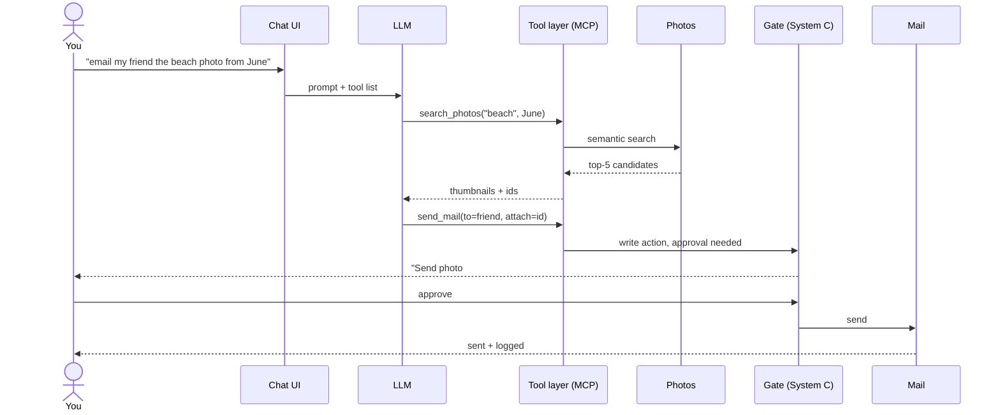
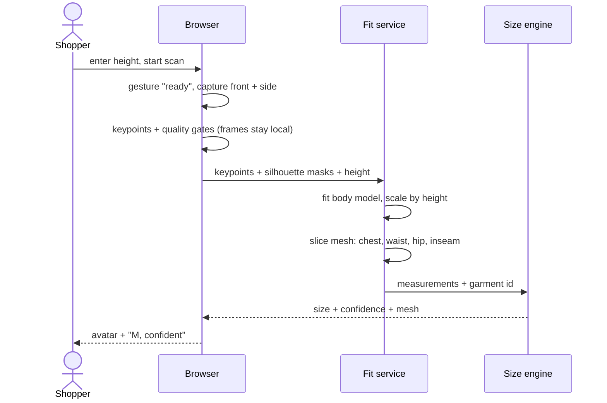
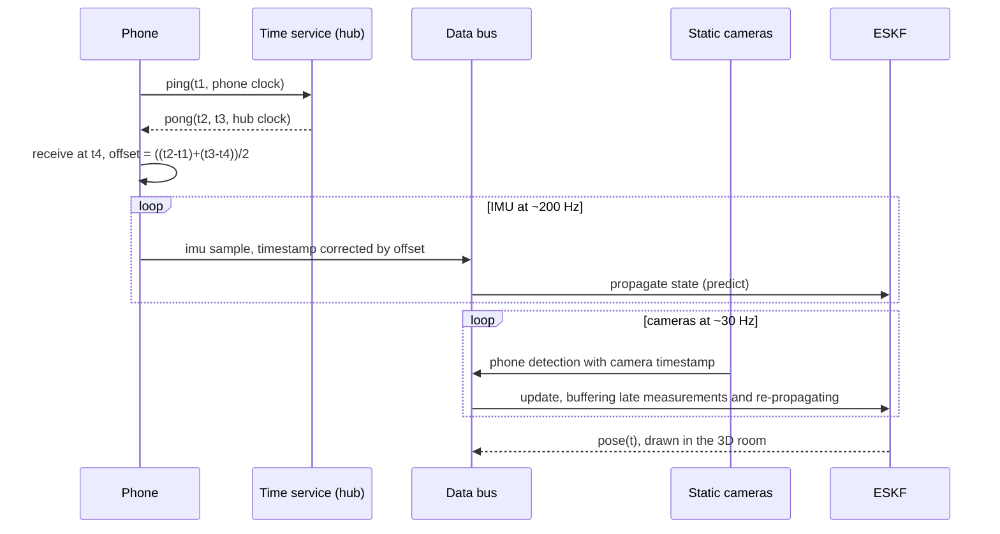

# Physical-AI Lab — Top-Down System Design

> **Draft v1 · 2026-10-20 · Owner: Ahmad**
> First the generalization from four hands-on tests, then a top-down design (L0 → L3) for each system.
> Every design ends with its **update step**: the measurements that turn generated code into a verified system.

## Contents

0. [How to read this](#0-how-to-read-this)
1. [The generalization: predict → update](#1-the-generalization-predict--update)
2. [L0 — the whole lab (system of systems)](#2-l0--the-whole-lab-system-of-systems)
3. [System A — Personal cloud (self-hosted "Google stack")](#3-system-a--personal-cloud-self-hosted-google-stack)
4. [System B — Forma (body scan → fit → try-on)](#4-system-b--forma-body-scan--fit--try-on)
5. [System C — Guarded agent ops (the "Linux architect" agent)](#5-system-c--guarded-agent-ops-the-linux-architect-agent)
6. [System D — Real-time multi-device sensor platform](#6-system-d--real-time-multi-device-sensor-platform)
7. [Build order across systems](#7-build-order-across-systems)
8. [Appendix — the four tests](#8-appendix--the-four-tests)

---

## 0. How to read this

```
L0  Purpose & boundary   what the system is for, and what is outside it
L1  Architecture         subsystems and how data moves between them
L2  Components           box → responsibility → candidate tech → swap boundary
L3  Key flows            sequence diagrams for the paths that matter
U   Update step          metrics that correct the design against reality
G   Gates                irreversible actions and who approves them
P   Phases               build order; each phase ends in a measurement
```

- Tech choices live **only at L2**, so they can be swapped without touching L0–L1.
- Candidate tech is open-source and self-hostable. Pin versions at build time.
- Numbers marked *target* are hypotheses until measured. Every status starts as **unmeasured**.

---

## 1. The generalization: predict → update

**AI turned engineering from a writing problem into an estimation problem.**
The agent is the predict step, and it is now nearly free. Reality is the update step, and it costs what it always did.

```
        2020: cost ≈ WRITING the system        2026: cost ≈ CORRECTING the system
        (people × years of code)               (measurements × authority)

      AI agent = PREDICT step                   Reality = UPDATE step
  ┌───────────────────────────────┐        ┌──────────────────────────────────┐
  │ x̂⁻ = f(spec)                  │        │ x̂ = x̂⁻ + K·(z − h(x̂⁻))          │
  │ code, configs, integrations   │ ─────▶ │ tests, ground truth, users,      │
  │ cost → ~0, takes minutes      │        │ clocks, physics, consent         │
  │ uncertainty P GROWS every run │        │ the only thing that SHRINKS P    │
  └───────────────────────────────┘        └──────────────────────────────────┘
        110k lines, 0 tests  ⇒  K = 0  ⇒  P unbounded
```

### Four laws

| # | Law | Meaning |
|---|-----|---------|
| 1 | **Generation is nearly free; verification costs what it always did** | Treat agent output as a prior. It is worth nothing until reality updates it. |
| 2 | **Features are commodity; properties aren't** | Accuracy, reliability, latency, trust and scale only exist once a system meets reality, and they cost what they always did. |
| 3 | **Capability grows faster than authority control** | The scarce safety asset is the gate on irreversible actions: disk wipes, deploys, sent messages, payments. |
| 4 | **Physics and people don't speed up** | Clocks, bandwidth, sensors, bodies and users all run at their old pace. |

### Three operating rules (applied in every system below)

1. **Write the measurement before you generate.** Each system's P0 is a number, not a feature.
2. **Give agents only reversible authority.** Snapshot first, dry-run by default, explicit yes for irreversible steps (System C).
3. **Track tests ÷ generated lines.** Near zero means prediction steps with no updates.

### Where jobs move (same law, seen from hiring)

The growing roles are **update-step jobs**:

- Forward-deployed engineers check software against a customer's reality.
- Defense and regulated work means owning irreversible decisions.
- Power, hardware and robotics work means owning the physics.

---

## 2. L0 — the whole lab (system of systems)

```
              ┌──────────────────────── outside world ────────────────────────┐
              │ internet · mail providers · model weights · retailers · you   │
              └──────────────────────────────▲────────────────────────────────┘
                                             │ WAN: overlay VPN only, no open ports
┌────────────────────────────────────────────┴───────────────────────────────────────┐
│                           PHYSICAL-AI LAB (home LAN)                               │
│                                                                                    │
│  ┌───────────────┐   ┌───────────────┐   ┌───────────────┐                         │
│  │ A. Personal   │   │ B. Forma      │   │ D. Sensor     │                         │
│  │    cloud      │◀──┤ scan → fit →  │   │    platform   │                         │
│  │ photos·drive  │LLM│ try-on        │   │ 5 devices,    │                         │
│  │ mail·search·AI│   │               │   │ real time     │                         │
│  └───────┬───────┘   └───────┬───────┘   └───────┬───────┘                         │
│          │                   │                   │                                 │
│  ┌───────▼───────────────────▼───────────────────▼───────────────────────────────┐ │
│  │ C. GUARDED AGENT OPS — every agent-made change to A, B, D passes through here │ │
│  └───────────────────────────────────┬───────────────────────────────────────────┘ │
│  ┌───────────────────────────────────▼───────────────────────────────────────────┐ │
│  │ SHARED PLATFORM: proxy · SSO · overlay VPN · storage tiers · backups ·        │ │
│  │                  observability · secrets · git (Forgejo)                      │ │
│  └───────────────────────────────────┬───────────────────────────────────────────┘ │
│  ┌───────────────────────────────────▼───────────────────────────────────────────┐ │
│  │ HARDWARE: Acer hub (Xubuntu, internal SSD) · external HDD (bulk + lite        │ │
│  │ Xubuntu) · MacBook Air 2020 · iPad Air 2 · Redmi Note 10 Pro · Logitech cam   │ │
│  └───────────────────────────────────────────────────────────────────────────────┘ │
└────────────────────────────────────────────────────────────────────────────────────┘
```

### Lab-wide rules (non-functional, apply to every system)

| Concern | Rule |
|---|---|
| Exposure | Nothing listens on the public internet. Remote access only through the overlay VPN. |
| Identity | One SSO in front of every web UI, with MFA. |
| Data | Raw personal data (photos, body frames, mail, camera logs) never leaves the lab unencrypted. |
| Backups | 3-2-1: SSD + HDD + encrypted offsite. Monthly restore drill; untested backups don't count. |
| Change | All agent-made changes go through System C. |
| Compute | The Acer is a budget laptop with integrated graphics. Heavy generation (video, large models) is a **GPU-tier** job: rented or added later. APIs are designed so that backend can move. If the MacBook Air is the M1 model, it is the better local-LLM box. |

### Shared platform — L2

| Component | Responsibility | Candidate tech | Swap boundary |
|---|---|---|---|
| Reverse proxy + TLS | Single entry point, routing | Caddy (or Traefik) | HTTP |
| SSO | One login, MFA | Authelia (light) or Authentik (full) | OIDC / forward-auth |
| Overlay network | Remote access without open ports | Tailscale or plain WireGuard | IP |
| Runtime | Isolation, reproducibility | Docker Compose, one file per system | compose file |
| Storage tiers | Hot data on SSD, bulk on HDD | Btrfs where snapshots matter, ext4 elsewhere | mount path |
| Backup | Encrypted, deduplicated | restic (or Borg) → second disk + offsite | repository |
| Observability | Health, disk space, alerts | Uptime Kuma + Netdata; Prometheus/Grafana later | metrics endpoint |
| Secrets | Nothing secret in git | `.env` outside the repo; age/sops for anything committed | file |
| Code + infra | Single source of truth | Forgejo | git remote |

---

## 3. System A — Personal cloud (self-hosted "Google stack")

### L0 — Purpose & boundary

**Own photos, files, mail, search and AI generation on your own hardware, with an LLM that can act across all of them.**

- **In scope:** the features, for one household.
- **Out of scope:** being Google. That means a web-scale index, internet-wide spam handling and five-nines uptime. You reproduce the features, not the service.

### Requirements

**Functional**
- Photos: auto-upload from phone and Mac; face and semantic search.
- Drive: sync folders across Mac, Acer and phone; share links.
- Mail: own domain; send, receive, search.
- Search: (a) private web metasearch; (b) "search my stuff" across photos, files and mail.
- AI: chat LLM, image → text, text → image, text → video.
- Integration: the LLM can call photos, drive, mail and search as tools.

**Non-functional (*targets*)**
- A phone photo is visible on the LAN in < 1 min.
- Recovery point ≤ 24 h. Restore tested monthly.
- Outbound mail lands in the Gmail/Outlook inbox, not spam.
- Personal search returns a known item in the top 5.
- Every tool call is logged. Write actions need approval (System C gate).

### L1 — Architecture

```
 clients: phone · Mac · iPad · browser
        │ HTTPS (LAN or overlay VPN)
 ┌──────▼──────────────────────────────────────────────────────────────┐
 │ edge: reverse proxy + SSO                                           │
 └──┬───────────┬───────────┬────────────┬──────────────┬──────────────┘
    │           │           │            │              │
 ┌──▼────┐  ┌───▼───┐  ┌────▼───┐  ┌─────▼─────┐  ┌─────▼──────────────┐
 │Photos │  │ Drive │  │ Mail   │  │ Search    │  │ AI services        │
 │       │  │       │  │        │  │ web + mine│  │ LLM · VLM · image  │
 │       │  │       │  │        │  │           │  │ video (GPU tier)   │
 └──┬────┘  └───┬───┘  └───┬────┘  └─────┬─────┘  └─────┬──────────────┘
    │           │          │   indexes ◀─┤ captions,    │
    │           │          │             │ embeddings ◀─┘
    └───────────┴────┬─────┴─────────────┘
                     │
        ┌────────────▼─────────────┐       ┌─────────────────────────────┐
        │ tool layer (MCP servers) │◀─────▶│ chat UI + agent             │
        │ photos·drive·mail·search │       │ reads free · writes gated   │
        └────────────┬─────────────┘       └─────────────────────────────┘
                     │
        ┌────────────▼─────────────┐
        │ SSD: databases, indexes  │
        │ HDD: media, blobs        │──▶ restic → second disk + offsite
        └──────────────────────────┘
```

### L2 — Components

| Box | Responsibility | Candidate tech | Notes |
|---|---|---|---|
| Photos | Upload, albums, faces, semantic search | Immich | Ships its own ML container for semantic and face search. Keep the library on the HDD. |
| Drive | Sync and share | Syncthing (simplest), Seafile (fast sync), or Nextcloud (full suite) | Pick one. Syncthing has no server UI. |
| Mail | Receive, store, send | Stalwart (all-in-one) or docker-mailserver | **Send outbound through an SMTP relay.** Residential IPs are commonly blocklisted and many ISPs block port 25. |
| Web search | Private metasearch | SearXNG | Still depends on upstream engines. It is a privacy layer, not an index. |
| Personal search | One query over photos, files and mail | Meilisearch or Typesense (keyword) + pgvector (embeddings) | An indexer pulls from each service's API. |
| LLM / VLM | Chat, captioning, extraction | Ollama or llama.cpp server (OpenAI-compatible API) | Small quantized models on CPU; bigger ones on the GPU tier. |
| Image / video generation | Text → image, text → video | ComfyUI, with workflows versioned as JSON in git | Video is GPU-tier. Queue the jobs; never block the UI. |
| Tool layer | Expose services to the LLM | One MCP server per service | Read tools are open. Write tools route through System C gates. |
| Chat UI | One front door to models and tools | Open WebUI or similar | |

### L3 — Key flow: "email a friend the beach photo from June"



### G — Gates

Approval is required for: send mail · delete photos or files · create a public share link · empty trash · change DNS or mail records.

### U — Update step

| Metric | How to measure | Target | Status |
|---|---|---|---|
| Restore works | Monthly: restore a random folder and album to a temp dir, compare hashes | 100 % | unmeasured |
| Backup freshness | Age of the newest snapshot | < 24 h | unmeasured |
| Mail deliverability | Send to Gmail and Outlook test inboxes; check SPF/DKIM/DMARC pass and inbox vs spam | inbox | unmeasured |
| Personal search recall | 20 known items, one query each | ≥ 18 in top 5 | unmeasured |
| LLM throughput | Tokens/s for the chosen model on the hub | set after first run | unmeasured |
| Uptime | Uptime Kuma, per service | ≥ 99 % per month | unmeasured |

### P — Phases

| Phase | Scope | Exit measurement |
|---|---|---|
| P0 | Shared platform + Photos + backups | First restore drill passes |
| P1 | Drive + personal search + LLM + read-only tool layer | Search recall measured |
| P2 | Mail through a relay + gated write tools | Inbox placement verified |
| P3 | Image/video generation on the GPU tier | Job queue latency measured |

---

## 4. System B — Forma (body scan → fit → try-on)

### L0 — Purpose & boundary

**From a webcam scan plus the user's height, produce body measurements accurate enough to recommend a size, then show the outfit on an avatar.**

- **Inputs:** webcam frames, height, a retailer catalog and size charts.
- **Outputs:** a size per garment with a confidence level, and an avatar view.
- **Out of scope for v1:** physically accurate cloth simulation.

**Constraints:**
- Webcam only, no depth sensor.
- No paid AI APIs.
- Django + React.
- Two cameras are available for calibration.
- MediaPipe Hands gesture control.

**The defining design fact:** a single camera has no absolute scale. The user's height fixes scale, so the error budget is dominated by the pose and body-model fit. That error is what must be measured first.

### Requirements

**Functional**
- Guided capture: front and side pose, controlled by hand gestures.
- Measurements: height, chest, waist, hip, inseam, shoulder width.
- Size recommendation per garment, from that garment's size chart.
- Voice or text intent → outfit suggestions.
- Avatar try-on view.

**Non-functional (*targets*)**
- Circumference error (MAE) **< half a size step on the retailer's chart**. This target is principled: anything larger flips the recommended size.
- Scan → measurements in < 30 s.
- **Raw frames never leave the browser.** Only keypoints, masks and height are sent.

### L1 — Architecture

```
 BROWSER (React)                           SERVER (Django)                    OFFLINE
┌──────────────────────────────┐         ┌──────────────────────────────┐   ┌────────────────┐
│ capture wizard               │         │ fit service                  │   │ validation set │
│  gesture control (hands)     │keypoints│  body-model fit, scaled by   │──▶│ tape-measured  │
│  pose keypoints (in-browser) │+ masks  │  height → mesh → measures    │   │ ground truth   │
│  quality gates (pose, light) │+ height │ size engine                  │   │ → error report │
│                              │────────▶│  measures × size charts      │   └────────────────┘
│ avatar viewer (three.js)     │◀────────│ intent + recommender         │
│ voice / text prompt          │ mesh +  │  speech-to-text → LLM →      │
└──────────────────────────────┘ sizes   │  structured query → catalog  │
   raw frames stay here                  │ try-on renderer (GPU tier)   │
                                         └──────────────┬───────────────┘
                                         ┌──────────────▼───────────────┐
                                         │ Postgres + pgvector: users,  │
                                         │ measures, catalog, charts,   │
                                         │ events (incl. kept/returned) │
                                         └──────────────────────────────┘
```

### L2 — Components

| Box | Responsibility | Candidate tech | Notes |
|---|---|---|---|
| Capture wizard | Guide front + side pose; reject bad frames | React + MediaPipe Tasks (Pose, Hands) in the browser | Quality gates: full body in frame, lighting, pose angle. |
| Keypoints | 2D landmarks, averaged over frames | MediaPipe Pose in the browser; RTMPose on the server if accuracy demands | Average N frames to cut jitter. |
| Body-model fit | Fit a parametric body (shape β, pose θ) to keypoints + silhouette, scaled by height | SMPL-family model fitted by optimization | ⚠ **License:** SMPL-family models are free for research, but commercial use needs a license. Settle this before pitching retailers. |
| Measurement extractor | Circumferences from the mesh at landmark heights | trimesh mesh slicing | Define each measurement exactly the way the retailer's tape does. |
| Size engine | Measurements → size per garment, with confidence | Rules over size charts first; learn from kept/returned data later | Output "M (confident)" or "M/L (between)". |
| Intent parser | Voice/text → {occasion, style, budget, colors} | Local Whisper-class speech-to-text + local LLM (System A), JSON-schema output | |
| Recommender | Retrieve and rank catalog items | Postgres + pgvector with image embeddings | |
| Try-on | Outfit on the avatar | v1: textured garment templates on the mesh; v2: image-based diffusion try-on on the GPU tier (check the model's license) | |

### L3 — Key flow: scan → size



### G — Gates

- Storing body data requires explicit consent and delete-on-request.
- Sharing data with a retailer is opt-in, per retailer.
- The validation set is append-only. Never delete ground truth.

### U — Update step

| Metric | How to measure | Target | Status |
|---|---|---|---|
| Circumference MAE | Tape-measure 10 people (→ 30 → 100) using the retailer's method; scan each 3×; compare | < half a size step | unmeasured |
| Repeatability | Same person, 3 scans | spread < 1 cm *target* | unmeasured |
| Size hit-rate | Recommended size vs the size the person actually keeps | ≥ 80 % *target* | unmeasured |
| Capture success | % of scans that pass the quality gates on the first try | ≥ 90 % | unmeasured |
| Reality ratio | Tests ÷ generated lines in the 110k | > 0, rising | ≈ 0 |

### P — Phases

| Phase | Scope | Exit measurement |
|---|---|---|
| **P0** | Capture → measurements → error report on 10 people. **Freeze all other code until this number exists.** | MAE per measurement |
| P1 | Size engine on 2–3 real size charts | Size hit-rate on the validation set |
| P2 | Intent parser + recommender | Relevance judged on 20 prompts |
| P3 | Try-on visuals | User preference test |
| P4 | Retailer API, only after P0 numbers exist | Pilot with one catalog |

---

## 5. System C — Guarded agent ops (the "Linux architect" agent)

### L0 — Purpose & boundary

**Let coding agents do senior-engineer infrastructure work (OS installs, partitions, services) at agent speed, while every irreversible action stays a human decision.**

- **Input:** your intent plus hard constraints.
- **Output:** a verified, reversible change and an audit trail.

**The incident, treated as data.** The plan was to keep Windows and dual-boot. The result was Windows wiped and Xubuntu on the internal SSD. Possible failure classes to design against:

1. **Intent drift.** The plan was not carried into the agent's session as a hard constraint.
2. **Device ambiguity.** When booting from an external disk, `/dev/sdX` and `nvme` names can point to different disks than expected. "The target disk" by name is unsafe.
3. **No authority tiers.** A disk wipe ran with the same authority as `ls`.

### Action tiers

```
 T0  READ          ls, cat, lsblk, journalctl              → auto
 T1  REVERSIBLE    edit config in git, install a package   → auto, logged
 T2  SNAPSHOTTED   service changes, upgrades, migrations   → auto once a snapshot exists
 T3  IRREVERSIBLE  wipefs, mkfs, parted/sgdisk, dd of=,    → STOP: plan + diff + typed
                   rm -rf outside the workspace, boot-        confirmation naming the disk
                   loader changes, send/publish/pay           by serial / UUID
```

### L1 — Architecture

```
 you ── intent + constraints ──▶ ┌──────────────┐
                                 │ agent        │ plans steps
                                 └──────┬───────┘
                                        │ proposed action
                                 ┌──────▼───────┐  T3   ┌─────────────────────────┐
                                 │ policy gate  │──────▶│ approval: you type the  │
                                 │ classify     │       │ disk serial + "yes"     │
                                 │ T0–T3,       │◀──────│                         │
                                 │ deny-list    │  ok   └─────────────────────────┘
                                 └──────┬───────┘
                        T2 / T3: ┌──────▼───────┐
                                 │ snapshot     │ Btrfs/LVM snapshot or disk image
                                 └──────┬───────┘
                                 ┌──────▼───────┐
                                 │ executor     │ allowlisted shell, scoped dirs
                                 └──────┬───────┘
                                 ┌──────▼───────┐  fail  ┌──────────┐
                                 │ verifier     │───────▶│ rollback │
                                 └──────┬───────┘        └──────────┘
                                 ┌──────▼───────┐
                                 │ audit log    │ append-only, committed to Forgejo
                                 └──────────────┘
```

### L2 — Components

| Box | Responsibility | Candidate tech | Notes |
|---|---|---|---|
| Constraint file | Carry the plan as hard rules across sessions | `CLAUDE.md`-style file in the infra repo: protected partitions, disk serials, allowed mounts | Same pattern as the `portable-settings` invariants. |
| Policy gate | Classify each command; block the deny-list | Agent harness permission rules + a pre-execution hook script | Default-deny for disk tools. |
| Disk identity | Never address disks by `/dev/sdX` | `/dev/disk/by-id/` (serial); `lsblk -o NAME,SERIAL,SIZE,MODEL` inventory before any T3 | Names can swap when booting from external media. |
| Snapshot | Make T2 reversible; preserve state before T3 | Btrfs + Snapper or Timeshift; partclone / `dd` image to the HDD before any partition-table change | Image the disk before touching its table. |
| Executor | Run approved commands | Non-root by default; sudo only for a specific approved T3 | |
| Verifier | Post-conditions per step | Scripted checks: expected partitions, mounts, boot entries, services up | |
| Audit | Who / what / when | Commands + outputs committed to git | |

### L3 — Key flow: repartition for dual boot

```mermaid
sequenceDiagram
    actor Y as You
    participant A as Agent
    participant P as Policy gate
    participant X as Executor
    participant S as Snapshot
    participant V as Verifier
    A->>P: plan: repartition internal disk for dual boot
    P->>P: classify as T3 (partition table)
    P->>X: T0 inventory: lsblk by serial
    X-->>P: disks, serials, current layout
    P-->>Y: diff: "disk SN… shrink p3, add p5; Windows p3 kept"
    Y->>P: types serial + "yes"
    P->>S: image partition table + Windows partition to HDD
    S-->>P: image hash ok
    P->>X: run exactly the approved commands
    X->>V: done
    V->>V: Windows partition intact? boot menu shows both?
    V-->>Y: pass, or rollback offered
```

### G — Gates

- Every T3 action from the tier table needs a typed confirmation naming the disk by serial or UUID.
- Editing the constraint file itself is T3. An agent can propose a change but can't apply one.
- Approvals cover a single action. One "yes" never carries over to the next command or the next session.

### U — Update step

| Metric | How to measure | Target | Status |
|---|---|---|---|
| Unapproved T3 actions | Scan the audit log | 0 | unmeasured |
| Plan vs apply | Dry-run plan compared with executed commands | identical | unmeasured |
| Rollback works | Quarterly drill: break a test VM or partition, roll back | pass | unmeasured |
| Constraint adherence | Violations of the constraint file | 0 | 1 incident so far |

### P — Phases

| Phase | Scope | Exit measurement |
|---|---|---|
| **P0** | Constraint file + disk-identity rule + deny-list for disk tools | A blocked T3 attempt shows up in the log |
| P1 | Snapshot service + verifier scripts | Rollback drill passes on the external HDD (the practice target) |
| P2 | Full T0–T3 policy gate for all agent sessions | 30 days, 0 unapproved T3 |

---

## 6. System D — Real-time multi-device sensor platform

### L0 — Purpose & boundary

**Stream and log cameras and sensors from 5 devices with minimal lag on the LAN (WAN later), time-aligned well enough to fuse.**

- **First milestone:** the webcam viewed on the iPad over the LAN.
- **End goal:** a 3D model of the room, with the phone's trajectory drawn in it.

### Device roles

| Device | Role | Streams |
|---|---|---|
| Acer (Xubuntu) | Hub: media server, data bus, recorder, fusion, viz | — |
| Logitech webcam (on the Acer) | Static camera 1 | video |
| MacBook Air 2020 | Static camera 2 + extra compute | video |
| Redmi Note 10 Pro | Moving sensor rig | camera, IMU (accel/gyro), step counter |
| iPad Air 2 | Viewer (old OS, so browser-only) | — |

### Requirements

**Functional**
- Live view of any camera on any device.
- Record every raw stream with timestamps.
- Replay recordings as a test bench.
- Live 3D view of the room and the phone's pose.

**Non-functional (*targets*)**
- Glass-to-glass video latency: LAN < 150 ms; WAN < 400 ms.
- **Clock alignment between streams < 5 ms.** This is the hard requirement for IMU + camera fusion.
- Drop rate < 0.1 % on the LAN.
- A device can drop and reconnect without restarting the hub.

### L1 — Architecture

```
 EDGE (devices)                        HUB (Acer)                              CONSUMERS
┌───────────────────┐            ┌───────────────────────────────────┐
│ webcam ───────────┼─ USB ─────▶│ media server (video in / out)     │─ WebRTC ─▶ iPad, browser
│ Mac camera ───────┼─ WebRTC ──▶│                                   │
│ phone camera ─────┼─ WebRTC ──▶│                                   │
│                   │            ├───────────────────────────────────┤
│ phone IMU, steps ─┼─ UDP/WS ──▶│ data bus (topics + timestamps)    │─────────▶ live viz
│                   │            ├───────────────────────────────────┤           (3D + plots)
│ every device:     │◀─ sync ───▶│ time service (offset + drift)     │
│ clock offset est. │            ├───────────────────────────────────┤
└───────────────────┘            │ recorder → MCAP files on HDD      │─────────▶ replay =
                                 ├───────────────────────────────────┤           test bench
                                 │ fusion: ESKF (IMU predicts,       │─────────▶ phone trajectory
                                 │ camera detections update)         │           in the 3D room
                                 ├───────────────────────────────────┤
                                 │ mapping: room model (offline,     │
                                 │ from a walkthrough video)         │
                                 └───────────────────────────────────┘
  WAN later: the same hub, reached only through the overlay VPN (+ a TURN relay for WebRTC if needed)
```

### L2 — Components

| Box | Responsibility | Candidate tech | Notes |
|---|---|---|---|
| Media server | Ingest USB/RTSP/WebRTC; re-serve as WebRTC | MediaMTX | WebRTC is the low-latency path. HLS only for non-live viewing. |
| Data bus | Timestamped sensor topics | ROS 2 on the LAN; Zenoh for WAN bridging; MQTT if staying light | One schema: `device_id, sensor, seq, t_device, t_hub, payload`. |
| Phone app | Camera + IMU + steps with hardware timestamps | Small Android app (SensorEvent timestamps) or an existing sensor-streaming app | Send device timestamps, never arrival time. |
| Time service | Per-device clock offset and drift | chrony/NTP on the Acer and Mac; phone: round-trip offset estimate each session | **Treat camera–IMU time offset as a filter state** and estimate it online. |
| Recorder | Everything to disk | MCAP files on the HDD | Replay drives every algorithm test. |
| Viz | Live and replay | Rerun or Foxglove | 3D + time series in one view. |
| Calibration | Static camera intrinsics and extrinsics | OpenCV with ChArUco boards | Puts both static cameras in one world frame. |
| Mapping | Room geometry | COLMAP or Gaussian splatting, offline from a walkthrough | Registered to the calibrated camera frame. |
| Fusion | Phone pose over time | Error-state Kalman filter: IMU propagates; static-camera detections of the phone update; ARCore pose as an optional extra measurement if the phone supports it | The predict → update loop of §1, literally. |

### L3 — Key flow: clock sync + fusion loop



### G — Gates

- Any WAN exposure goes through the overlay VPN only. Opening a router port is T3.
- Raw camera recordings include people in view, so set a retention rule and delete on schedule.
- Deleting a recording that belongs to a validation set needs approval.

### U — Update step

| Metric | How to measure | Target | Status |
|---|---|---|---|
| Glass-to-glass latency | Film a running millisecond clock through the pipeline; photograph the clock and the viewer together | LAN < 150 ms | unmeasured |
| Clock offset error | A sharp event (clap or tap) seen by the camera and felt by the IMU; compare timestamps | < 5 ms | unmeasured |
| Drop rate | Gaps in sequence numbers, per topic | < 0.1 % | unmeasured |
| Trajectory error | Walk a taped square or other known path in the room; compare to the estimate | set after first run | unmeasured |
| Reconnect | Turn the phone's Wi-Fi off for 10 s | streams resume without a hub restart | unmeasured |

### P — Phases

| Phase | Scope | Exit measurement |
|---|---|---|
| **P0** | Webcam → iPad over the LAN (first milestone) | Glass-to-glass latency |
| P1 | All 5 devices + recorder + shared timestamp schema | Drop rate + clock offset error |
| P2 | Camera calibration + room model | Reprojection error |
| P3 | ESKF phone trajectory, on replay first, then live | Error on the taped path |
| P4 | WAN through the overlay VPN | WAN latency |
| P5 | Local AI models running on the streams | Per-model latency on the hub |

---

## 7. Build order across systems

```
  C  guarded agent ops      ──▶ gates every change an agent makes from here on
  │
  ▼
  A-P0  platform + backups  ──▶ nothing new gets stored before a restore has been tested
  │
  ├──▶ D-P0/P1  sensor platform    measure latency and clock error early
  ├──▶ B-P0     Forma measurement  10 people, one error report
  └──▶ A-P1+    rest of the personal cloud
```

**Why this order:** System C and the backups are the only pieces that lower the cost of every later mistake. After that, each system's P0 is its first measurement, not its first feature.

---

## 8. Appendix — the four tests

| Test | What AI collapsed | What it didn't touch |
|---|---|---|
| Self-hosted Google stack | The integration work: wiring open-source photos, files, mail, LLMs and diffusion models into one system on your own hardware | What makes Google *Google*: a web-scale index, mail that actually gets delivered (sender reputation), near-perfect uptime, abuse handling. You reproduced the features, not the service. |
| Forma, 110k lines in a day | Writing the prototype: months of work for a small team became one day for one person | Validated fit accuracy. The 2020 baseline is overstated: the SMPL body model (2015), OpenPose (2017) and PIFu (2019) let a small team prototype this in months. The "1000 people × 8 years" was for a *validated* product (datasets, measurement accuracy, retail integration, proof it cuts returns), and that layer is still ahead. |
| "5-year Linux architect" agent | Expert execution: partitioning, installs and config at senior-engineer speed | Judgment about irreversible actions. The plan was to keep Windows and dual-boot; one instruction ended with a whole-disk wipe. Capability grew; control over irreversible actions didn't. |
| 5-device real-time platform | The plumbing: streaming, protocols, LAN and WAN glue | Physics: the latency floor, jitter, and clock drift between devices. For fusing the phone's IMU with the cameras, keeping five clocks in sync is the real problem. |
